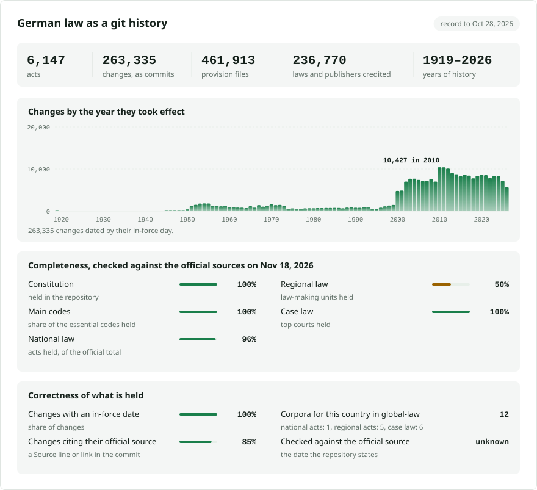

# Germany: law history in git

**English** · **[Oder auf Deutsch lesen](README.md)**

<picture>
<source media="(prefers-color-scheme: dark)" srcset="data/effort-dark.svg">

</picture>

The law of Germany as a git history: federal, Land and local law, official gazettes, parliamentary papers and court decisions, one file per provision or document, one commit per version or official record on its day (the day it took effect, or was issued, debated or decided), and the law or body it comes from as the commit's author. `git blame` names the law behind every line; `git log` lists every change to a provision; picking a date gives the text in force that day.

Part of [lexifina/global-law](https://github.com/lexifina/global-law), one git history for every country's law: global-law reads this repository's federal law at `germany/bund/acts/`.

**What is in it now:** about 6.7 million commits (19 November 2026): the Grundgesetz since 1949, every federal act since 2019 (earlier versions for about 2,000) and the Bundesgesetzblatt since 1949 ([`grundgesetz/`](grundgesetz/), [`bund/`](bund/)); the consolidated law of seven Länder, the gazettes and parliamentary papers of most ([`laender/`](laender/)); decisions of the federal courts and courts in ten Länder ([`rechtsprechung/`](rechtsprechung/)); the papers and plenary records of the Bundestag since 1949 and of the Bundesrat since 2000 ([`bundestag/`](bundestag/), [`bundesrat/`](bundesrat/)); local law and council records ([`kommunen/`](kommunen/)); and four historical constitutions ([`historisch/`](historisch/)). Each part's source: [`REPRODUCE.md`](REPRODUCE.md).

The Grundgesetz is in `grundgesetz/artikel/`, one file per article (`109.md` is Article 109, the budgets of the Federation and the Länder); every other federal act is a folder in `bund/gesetze/`, named as on Gesetze im Internet, one file per provision (`bund/gesetze/burlg/0003.md` is § 3 of the Bundesurlaubsgesetz, the Federal Leave Act). Until 17 November 2026 these folders were at the top of the repository (`burlg/`); `git log --follow` follows the move, and [`data/paths.json`](data/paths.json) maps each old folder to its new one.

The text is in German, as its sources publish it. An English translation is not part of this record.

## Questions as git commands

| Question | Command |
| --- | --- |
| Every change to Article 109 of the Grundgesetz | `git log -p --word-diff -- grundgesetz/artikel/109.md` |
| Which amending law wrote each line of Article 109? | `git blame grundgesetz/artikel/109.md` |
| Every version of Article 109, with the day each took effect | `git log --format="%h %(trailers:key=In-Kraft,valueonly,separator=) %an" -- grundgesetz/artikel/109.md` |
| Article 109 as in force on 1 January 2025 | `python tools/stand_am.py 2025-01-01 109` |

**Outside git**, we also host this record publicly, for free:

- **[Ask Claude about German law](https://global-law.lexifina.com/v1/try_claude?country=germany)**: opens Claude with a first question ready.
- **[Ask ChatGPT](https://global-law.lexifina.com/v1/try_chatgpt?country=germany)**: the same question in ChatGPT.
- **[Search German law on our site](https://lexifina.com/law?country=germany&q=Jahresurlaub)**: a search for "Jahresurlaub", with each provision's text and its versions, no account needed.
- **[Developer REST API](https://global-law.lexifina.com/v1/search_law?query=Jahresurlaub&jurisdiction=germany)**: the same search as JSON, with no key. See the [documentation here](https://lexifina.com/api/global-law).

Both assistants read the record through the free Global law connector (MCP, `https://global-law.lexifina.com/mcp`); the first time, the chat gives you the link that adds it. Ask in German or in English.

**Host it yourself easily.** All it takes is git and Python, and the tools run on your machine:

```sh
git clone --depth 1 https://github.com/lexifina/global-law && cd global-law
python3 tools/countries.py add germany/bund/acts
python3 tools/law.py show 2026-01-01 germany/bund/acts/grundgesetz/artikel/109.md
```

Opened in Claude Code, Cursor, VS Code or Codex, the clone also starts a local MCP server with the same tools ([MCP.md](https://github.com/lexifina/global-law/blob/main/MCP.md)).

## Dates

Each commit of the Grundgesetz and of federal law is dated at noon, Europe/Berlin, on the day the version took effect, and carries it in its `In-Kraft:` trailer; the other parts are dated by their document's day (issue, sitting, decision or start of validity):

- for the Grundgesetz, the day each amending law took effect, and, where known, the days it was passed, signed and promulgated (`Beschlossen:`, `Ausgefertigt:`, `Verkuendet:`); where a law sets no day, Article 82(2) GG puts it in force on the fourteenth day after the Bundesgesetzblatt issue appeared;
- for other federal law, the day the change first appeared on Gesetze im Internet, which consolidates changes as they take effect (the archive read it weekly until May 2020, daily since); where the act's footnotes give an earlier in-force day (`mWv 21.5.2003`), the commit also carries `In-Kraft-laut-Fussnote:`;
- git cannot store dates before 1970, so commits for earlier days are dated from 1970-01-01, seconds apart; the real day is in `In-Kraft:` and the `in-kraft/YYYY-MM-DD` tags for the Grundgesetz, and at the start of the subject line elsewhere. Ask for a date with `tools/stand_am.py`, not `git log --before`.

Each change is credited to the law that made it: `69. Änderung (2025)` for the 69th amending law to the Grundgesetz, or `G v. 22.12.2025 I Nr. 371` for federal law, as the act's Stand note names it. Changes no law explains are labelled, never credited to a law: `Gesetze im Internet (Bestand)` for the first state of 2019, `Textänderung ohne neue Standangabe` (1,160 of the first build's 3,232 federal commits), `Neu aufgenommen` and `Nicht mehr veröffentlicht`.

## How it is checked

- The Grundgesetz's final text equals today's official text on Gesetze im Internet, article for article. DocPatch's text differed from it in 43 articles; the official text replaces it from each article's last change on, and every correction is listed in [`grundgesetz/KORREKTUREN.md`](grundgesetz/KORREKTUREN.md).
- The dates of the 64th to 69th amending laws were checked against each law in the Bundesgesetzblatt.
- The first build is deterministic: the commands in [`REPRODUCE.md`](REPRODUCE.md) give its 3,304 law commits (the Grundgesetz and federal law to 28 October 2026) with the same hashes.
- History is append-only: later runs add commits on top and nothing is rewritten; withdrawals and corrections are labelled commits of their own (`Kind: withdrawal`, `Kind: correction`).
- [vulnerabilities/](vulnerabilities/README.en.md): possible drafting mistakes in German law, found by global-law's detectors and checked by hand.

## What it does not show

- **All federal law before 10 June 2019**, other than the Grundgesetz. Gesetze im Internet keeps only the current text; earlier versions of about 2,000 acts are rebuilt from the Bundesgesetzblatt ([`bund/fassungen-vor-2019/`](bund/fassungen-vor-2019/)), often only a few versions back.
- **Older Grundgesetz versions checked against the Gazette.** The versions of an article before its last change before 2019 are DocPatch's transcription.
- **The exact in-force day** of a federal change where the footnotes do not give it, and the stages of a law that takes effect in several steps under one Stand note.
- **Footnotes and images.** Footnotes are left out; images are marked `[Bild: …]`.
- **The consolidated law of the other nine Länder** (their gazettes are here, except those of Saarland and Saxony-Anhalt), **EU law and the by-laws of most municipalities.** Sources that are blocked or not freely available are named in [`REPRODUCE.md`](REPRODUCE.md).

## Sources

| Source | Kind | Past versions | Notes |
| --- | --- | --- | --- |
| [Gesetze im Internet](https://www.gesetze-im-internet.de) (Bundesministerium der Justiz) | Official consolidated text of federal law | no, the current text only | Every act, and the Grundgesetz from 2019; only the Bundesgesetzblatt is authoritative |
| [QuantLaw/gesetze-im-internet](https://github.com/QuantLaw/gesetze-im-internet) | Archive of Gesetze im Internet | yes, weekly from 10 June 2019, daily from May 2020 | Where the past versions of federal acts come from |
| [DocPatch](https://github.com/c3e/grundgesetz-dev) | The Grundgesetz of 1949 and its 1st to 63rd amending laws, as patches | yes, every version | With dates, signatories, Gazette citations and votes |
| [Deutscher Bundestag, Datenhandbuch](https://www.bundestag.de/datenhandbuch) | Dates of the 64th to 69th amending laws | | Checked against the Bundesgesetzblatt |
| The publisher of each other part (gazettes, parliaments, courts, councils, cities) | Gazettes, parliamentary papers, decisions, local law | as published | Each with its access and terms in [`REPRODUCE.md`](REPRODUCE.md) and [`LICENSE`](LICENSE) |

## Licence

See [`LICENSE`](LICENSE). German statutes, ordinances, official notices and court decisions are not protected by copyright (§ 5 Abs. 1 UrhG); other material keeps its source's terms (among them CC BY-SA 3.0 DE for DocPatch, BSD-3-Clause for QuantLaw, the Datenlizenz Deutschland and a library scan for non-commercial use), all listed in `LICENSE`. Lexifina's own work is released under CC0 1.0.

The legal text comes from the sources (scans by OCR, labelled); an AI model wrote the scripts and prepared the labelled corrections, each with its evidence (see [`REPRODUCE.md`](REPRODUCE.md)).

## Visualisations

- [visualisations/](visualisations/README.en.md): charts drawn from this repository. Not drawn yet.

## More

From [lexifina/global-law](https://github.com/lexifina/global-law):

- [FEATURES.md](https://github.com/lexifina/global-law/blob/main/FEATURES.md): every feature, and what every corpus must support (`git blame`, `law.py`, the MCP tools)
- [FAQ.md](https://github.com/lexifina/global-law/blob/main/FAQ.md): questions and answers · [CONTRIBUTING.md](https://github.com/lexifina/global-law/blob/main/CONTRIBUTING.md): proposing changes · [MCP.md](https://github.com/lexifina/global-law/blob/main/MCP.md): the MCP server · [REPRODUCE.md](https://github.com/lexifina/global-law/blob/main/REPRODUCE.md): how it was built · [CHANGELOG.md](https://github.com/lexifina/global-law/blob/main/CHANGELOG.md)
- [FRESHNESS.md](https://github.com/lexifina/global-law/blob/main/FRESHNESS.md): how current each corpus is · [Monitoring](https://github.com/lexifina/global-law/tree/main/monitoring): whether updates are running · [WATCHING.md](https://github.com/lexifina/global-law/blob/main/WATCHING.md): how each official source is watched for changes
- [performance/](https://github.com/lexifina/global-law/tree/main/performance): how fast the tools are, measured
- [visualisations/](https://github.com/lexifina/global-law/tree/main/visualisations): charts and bridges across the world's law
- [Vulnerabilities](https://github.com/lexifina/global-law/tree/main/vulnerabilities): mistakes in legislation as published
