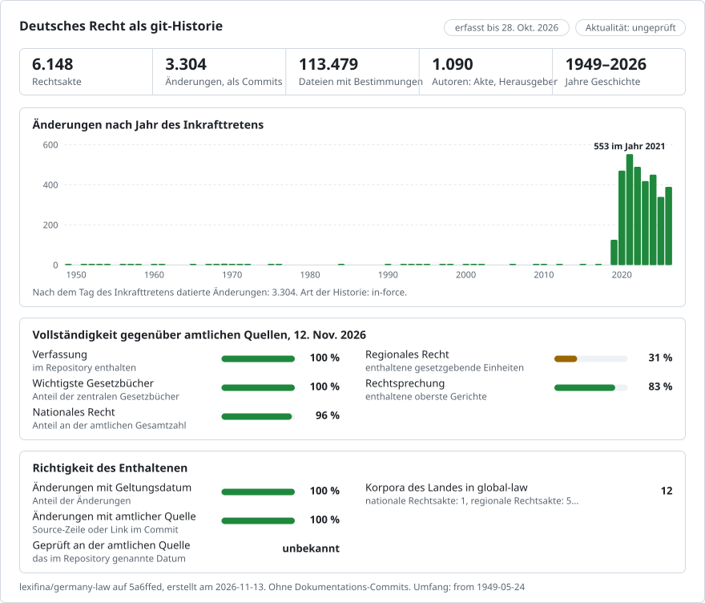

# Deutsches Recht, Änderung für Änderung

**Deutsch** · [English](README.en.md)

<picture>
<source media="(prefers-color-scheme: dark)" srcset="data/de/effort-dark.svg">

</picture>

Teil von [lexifina/global-law](https://github.com/lexifina/global-law), einer Git-Historie für das Recht jedes Landes: Dies ist das Bundesrecht Deutschlands, das global-law unter `germany/bund/acts/` einliest.

Deutsches Recht als ein Git-Repository. Jeder Commit ist das Inkrafttreten eines Gesetzes und wird diesem Gesetz zugeschrieben, sodass `git log` die Geschichte des Rechts ist und `git blame` zeigt, welches Gesetz jede Zeile geschrieben hat.

| Teil | Ordner | Ab | Text |
| --- | --- | --- | --- |
| Das Grundgesetz | [`grundgesetz/`](grundgesetz) | 23. Mai 1949 | eine Datei je Artikel, jede Fassung, jedes Änderungsgesetz auf den Tag seines Inkrafttretens datiert |
| Das übrige Bundesrecht (6.147 Gesetze) | [ein Ordner je Gesetz (`bgb/`, `stgb/` …)](verzeichnis.json) | 10. Juni 2019 | eine Datei je Gesetz, jede seitdem auf Gesetze im Internet veröffentlichte Änderung |
| Landesrecht | `laender/` | | noch nicht enthalten |

## Juristische Fragen als Git-Befehle

| Frage | Befehl |
| --- | --- |
| Was sagte Artikel 16 GG am 1. Juni 1993? | `python tools/stand_am.py 1993-06-01 16` |
| Was sagte das BGB am 1. Juli 2021? | `python tools/stand_am.py 2021-07-01 --gesetz bgb` |
| Welches Gesetz hat welchen Absatz von Artikel 1 GG geschrieben? | `git blame grundgesetz/artikel/001.md` |
| Welche Wörter hat jede Änderung des StGB ersetzt? | `git log -p --word-diff stgb/` |
| Was hat ein einzelnes Änderungsgesetz in allen Gesetzen geändert? | `git log --author='G v. 22.12.2025' --stat` |
| Wann ist jede Änderung in Kraft getreten? | `git log --format='%(trailers:key=In-Kraft,valueonly) %s'` |
| Welche Artikel des Grundgesetzes wurden am häufigsten geändert? | `git log --format= --name-only -- grundgesetz/artikel \| sort \| uniq -c \| sort -rn \| head` |
| Wo ist der Reader zu einer Grundgesetzänderung? | der Trailer `Reader:`, z. B. `git log -1 --format='%(trailers:key=Reader,valueonly)' gg/36` |
| Das gesamte Grundgesetz an einem bestimmten Tag | `git checkout "$(git tag --list 'in-kraft/*' \| awk -v d='in-kraft/1990-10-03' '$0 <= d' \| tail -1)"` |

In PowerShell lautet der letzte Befehl `git checkout (git tag --list 'in-kraft/*' | Where-Object { $_ -le 'in-kraft/1990-10-03' } | Select-Object -Last 1)`.

Nach einem Neuaufbau dieses Repositorys (siehe `REPRODUCE.md`) ist ein bestehender Klon mit `git fetch --force --tags` zu aktualisieren, sonst bleiben die alten Tags bestehen.

## Die Daten und welches verwendet wird

Ein Gesetz hat mehrere Daten: vom Bundestag beschlossen (`Beschlossen`), ausgefertigt (`Ausgefertigt`), im Bundesgesetzblatt verkündet (`Verkuendet`) und in Kraft getreten (`In-Kraft`). Das Datum des Inkrafttretens entscheidet, welcher Text gilt; daher sind die Commits auf dieses Datum datiert, 12 Uhr Berliner Zeit. Bestimmt ein Gesetz keinen Tag, tritt es nach Artikel 82 Abs. 2 des Grundgesetzes am vierzehnten Tag nach Ausgabe des Bundesgesetzblattes in Kraft. Die Trailer-Schlüssel bestehen aus ASCII-Zeichen, damit Git sie lesen kann.

- **Commits zum Grundgesetz** tragen alle vier Daten, aus den unten genannten Quellen. Git kann kein Datum vor 1970 speichern: Commits für Änderungen, die vorher in Kraft getreten sind, sind auf den 1. Januar 1970 (UTC) datiert, in ihrer Reihenfolge jeweils eine Sekunde auseinander; ihre tatsächlichen Daten stehen in der Commit-Nachricht und in den Tags `in-kraft/YYYY-MM-DD`.
- **Commits zum Bundesrecht** sind auf den Tag datiert, an dem die Änderung im konsolidierten Text wirksam wurde, und tragen diesen Tag als `In-Kraft:`: den Tag, an dem Gesetze im Internet sie veröffentlicht hat, was dort mit dem Inkrafttreten der Änderungen geschieht (bis Mai 2020 innerhalb einer Woche, seitdem innerhalb eines Tages). So bleibt die Historie in zeitlicher Reihenfolge und kann nur wachsen. Wo die Fußnoten des Gesetzes selbst ein früheres Datum des Inkrafttretens angeben (`mWv 21.5.2003`), bei einer verspäteten Konsolidierung oder einer rückwirkenden Änderung, trägt der Commit zusätzlich `In-Kraft-laut-Fussnote:`. `Beobachtet:` ist der genaue Zeitpunkt, zu dem die Änderung zuerst erfasst wurde. Die Tags `stand/YYYY-MM-DD` markieren jedes Gesetz so, wie es an diesem Tag veröffentlicht war.

## Was „Autor“ bedeutet

Autor jedes Commits ist das Gesetz, das die Änderung vorgenommen hat: `36. Änderung (1990)` für das 36. Gesetz zur Änderung des Grundgesetzes oder, beim Bundesrecht, `G v. 22.3.2025 I Nr. 94` (Gesetz vom 22. März 2025, Bundesgesetzblatt 2025 Teil I Nr. 94), wie es im Standvermerk des Gesetzes genannt ist. Die Adressen enden auf `.invalid`. Änderungen, die kein Gesetz erklärt, werden nie einem Gesetz zugeschrieben:
- der erste Stand der Bundesgesetze ist `Gesetze im Internet (Bestand)`;
- Text, der sich geändert hat, während der Standvermerk des Gesetzes noch dasselbe Gesetz nennt, ist `Textänderung ohne neue Standangabe`;
- Gesetze, die ohne Nennung eines Gesetzes hinzugekommen sind oder nicht mehr veröffentlicht werden, sind `Neu aufgenommen` und `Nicht mehr veröffentlicht`.

## Woher der Text stammt und wie er geprüft wird

- **Das Grundgesetz bis 2019** stammt aus [DocPatch](https://github.com/c3e/grundgesetz-dev), das jedes Änderungsgesetz bis zum 63. als Patch erfasst. Dessen Text von 2019 wurde Artikel für Artikel mit dem amtlichen Text auf [Gesetze im Internet](https://www.gesetze-im-internet.de/gg/) verglichen. Sie wichen in 43 Artikeln voneinander ab, teils im Wortlaut (in Artikel 3 Abs. 3 fehlte der 1994 eingefügte Satz zur Behinderung). Für jeden dieser Artikel ersetzt der amtliche Text den von DocPatch ab der letzten Änderung des Artikels. Jede Korrektur ist in [`grundgesetz/KORREKTUREN.md`](grundgesetz/KORREKTUREN.md) aufgeführt.
- **Das Grundgesetz ab 2019 und das gesamte Bundesrecht** stammen aus dem amtlichen konsolidierten Text auf Gesetze im Internet (Bundesministerium der Justiz), das nur die jeweils geltende Fassung vorhält, und zwar über [das Archiv von QuantLaw](https://github.com/QuantLaw/gesetze-im-internet), das ihn seit dem 10. Juni 2019 wöchentlich und seit Mai 2020 täglich speichert.
- **Geprüft:** Der Endtext des Grundgesetzes stimmt Artikel für Artikel mit dem heutigen amtlichen Text überein. Der Aufbau ist deterministisch: Dieselben Quellen ergeben dieselben Commits.

## Was das Repository nicht zeigt

- Bundesrecht außer dem Grundgesetz vor dem 10. Juni 2019. Eine Rekonstruktion aus dem Bundesgesetzblatt ist geplant.
- Fassungen eines Grundgesetzartikels, die älter sind als seine letzte Änderung vor 2019; sie sind die Transkription von DocPatch und wurden nicht mit dem Bundesgesetzblatt abgeglichen.
- Der genaue Tag, an dem eine bundesrechtliche Änderung in Kraft trat, wo die Fußnoten ihn nicht angeben, und die Stufen eines Gesetzes, das unter einem Standvermerk in mehreren Schritten in Kraft tritt.
- Fußnoten und Bilder. Landesrecht. EU-Recht.

Die konsolidierten Texte sind nicht die amtliche Verkündung. Maßgeblich ist allein das Bundesgesetzblatt. Dies ist ein Hilfsmittel für die Recherche.

## Lizenz

Deutsche Gesetze sind nicht urheberrechtlich geschützt (§ 5 Abs. 1 UrhG). Die eigenen Inhalte von DocPatch stehen unter CC BY-SA 3.0 DE, das Archiv von QuantLaw unter BSD-3-Clause. Dieses Repository wird unter CC0 1.0 veröffentlicht ([`LICENSE`](LICENSE)). Es wird von Lexifina Watch mit den Skripten in [`tools/`](tools) erstellt. [`REPRODUCE.md`](REPRODUCE.md) verzeichnet jede Quelle, jeden Befehl, jede Prüfsumme und jede Entscheidung sowie, was ein KI-Modell getan und nicht getan hat.

Dies ist eine Übersetzung der englischen Fassung ([README.en.md](README.en.md)); bei Abweichungen gilt die englische Fassung.

## Mehr

Aus dem Repository [lexifina/global-law](https://github.com/lexifina/global-law) (auf Englisch):

- [FEATURES.md](https://github.com/lexifina/global-law/blob/main/FEATURES.md): alle Funktionen und was jedes Korpus unterstützen muss (`git blame`, `law.py`, MCP-Werkzeuge)
- [FAQ.md](https://github.com/lexifina/global-law/blob/main/FAQ.md): Fragen und Antworten · [CONTRIBUTING.md](https://github.com/lexifina/global-law/blob/main/CONTRIBUTING.md): Änderungen vorschlagen · [MCP.md](https://github.com/lexifina/global-law/blob/main/MCP.md): MCP-Server · [REPRODUCE.md](https://github.com/lexifina/global-law/blob/main/REPRODUCE.md): wie es erstellt wurde · [CHANGELOG.md](https://github.com/lexifina/global-law/blob/main/CHANGELOG.md)
- [FRESHNESS.md](https://github.com/lexifina/global-law/blob/main/FRESHNESS.md): wie aktuell jedes Korpus ist · [Überwachung](https://github.com/lexifina/global-law/tree/main/monitoring): ob die Aktualisierungen funktionieren · [WATCHING.md](https://github.com/lexifina/global-law/blob/main/WATCHING.md): wie jede amtliche Quelle auf Änderungen überwacht wird
- [performance/](https://github.com/lexifina/global-law/tree/main/performance): wie schnell die Werkzeuge sind, gemessen
- [visualisations/](https://github.com/lexifina/global-law/tree/main/visualisations): Diagramme und Verbindungen im Recht der ganzen Welt
- [Schwachstellen](https://github.com/lexifina/global-law/tree/main/vulnerabilities): Fehler in Rechtsakten, wie sie veröffentlicht wurden
