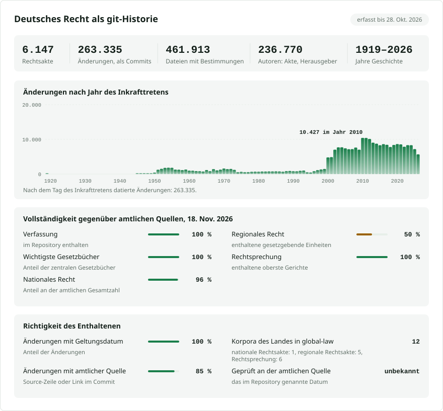

# Deutschland: die Geschichte des Rechts in Git

**Deutsch** · **[Or read it in English](README.en.md)**

<picture>
<source media="(prefers-color-scheme: dark)" srcset="data/de/effort-dark.svg">

</picture>

Das Recht Deutschlands als Git-Historie: eine Datei je Artikel des Grundgesetzes und je Norm jeder anderen Rechtsvorschrift des Bundes, ein Commit je Fassung an dem Tag, an dem sie in Kraft trat, und als Autor des Commits das Gesetz, das die Änderung vorgenommen hat. `git blame` nennt zu jeder Zeile das Gesetz, das sie geschrieben hat; `git log` listet jede Änderung einer Vorschrift auf; ein gewähltes Datum ergibt den an diesem Tag geltenden Text.

Teil von [lexifina/global-law](https://github.com/lexifina/global-law), einer Git-Historie für das Recht jedes Landes: Dies ist das Bundesrecht Deutschlands, das global-law unter `germany/bund/acts/` einliest.

**Was es jetzt enthält:** das Grundgesetz mit jeder Fassung seit 1949 (der Text von 1949 und seine 69 Änderungsgesetze, in 72 Commits) sowie 6.147 weitere Rechtsvorschriften des Bundes aus Gesetze im Internet, mit 16.392 Fassungen seit dem 10. Juni 2019. [`verzeichnis.json`](verzeichnis.json) verzeichnet jede Rechtsvorschrift mit Abkürzung, Titel und Fundstelle; [`grundgesetz/gesetze.csv`](grundgesetz/gesetze.csv) verzeichnet die Änderungsgesetze mit ihren Daten und Abstimmungsergebnissen.

Das Grundgesetz liegt in `grundgesetz/artikel/`, eine Datei je Artikel (`109.md` ist Artikel 109, Haushaltswirtschaft in Bund und Ländern); jede andere Rechtsvorschrift ist ein Ordner, benannt wie auf Gesetze im Internet, mit einer Datei je Norm (`burlg/0003.md` ist § 3 des Bundesurlaubsgesetzes).

Der Text ist deutsch, so wie Gesetze im Internet ihn veröffentlicht. Eine englische Übersetzung ist nicht Teil dieses Bestands.

## Fragen als Git-Befehle

| Frage | Befehl |
| --- | --- |
| Jede Änderung von Artikel 109 des Grundgesetzes | `git log -p --word-diff -- grundgesetz/artikel/109.md` |
| Welches Änderungsgesetz hat jede Zeile von Artikel 109 geschrieben? | `git blame grundgesetz/artikel/109.md` |
| Jede Fassung von Artikel 109, mit dem Tag ihres Inkrafttretens | `git log --format="%h %(trailers:key=In-Kraft,valueonly,separator=) %an" -- grundgesetz/artikel/109.md` |
| Artikel 109 in der am 1. Januar 2025 geltenden Fassung | `python tools/stand_am.py 2025-01-01 109` |

**Außerhalb von Git** stellen wir diesen Bestand auch öffentlich und kostenlos bereit:

- **[Claude zum deutschen Recht fragen](https://global-law.lexifina.com/v1/try_claude?country=germany)**: öffnet Claude mit einer vorbereiteten ersten Frage.
- **[ChatGPT fragen](https://global-law.lexifina.com/v1/try_chatgpt?country=germany)**: dieselbe Frage in ChatGPT.
- **[Die API im Browser aufrufen](https://global-law.lexifina.com/v1/search_law?query=Jahresurlaub&jurisdictions=germany)**: eine Suche nach „Jahresurlaub“ im deutschen Recht, Antwort als JSON. Die [Dokumentation steht hier](https://lexifina.com/api/global-law).

Beide Assistenten lesen den Bestand über den kostenlosen Global-law-Connector (MCP, `https://global-law.lexifina.com/mcp`); beim ersten Mal gibt der Chat Ihnen den Link, mit dem er hinzugefügt wird. Fragen Sie auf Deutsch oder auf Englisch.

**Einfach selbst betreiben.** Es braucht nur Git und Python, und die Werkzeuge laufen auf Ihrem Rechner:

```sh
git clone --depth 1 https://github.com/lexifina/global-law && cd global-law
python3 tools/countries.py add germany/bund/acts
python3 tools/law.py show 2026-01-01 germany/bund/acts/grundgesetz/artikel/109.md
```

In Claude Code, Cursor, VS Code oder Codex geöffnet, startet der Klon auch einen lokalen MCP-Server mit denselben Werkzeugen ([MCP.md](https://github.com/lexifina/global-law/blob/main/MCP.md)).

## Daten

Jeder Commit ist auf 12 Uhr Berliner Zeit (Europe/Berlin) an dem Tag datiert, an dem die Fassung in Kraft trat, und trägt diesen Tag in seinem Trailer `In-Kraft:`:

- beim Grundgesetz der Tag, an dem jedes Änderungsgesetz in Kraft trat, und, soweit bekannt, die Tage, an denen es beschlossen, ausgefertigt und verkündet wurde (`Beschlossen:`, `Ausgefertigt:`, `Verkuendet:`); bestimmt ein Gesetz keinen Tag, tritt es nach Art. 82 Abs. 2 GG am vierzehnten Tag nach Ausgabe des Bundesgesetzblattes in Kraft;
- beim übrigen Bundesrecht der Tag, an dem die Änderung zuerst auf Gesetze im Internet erschien, das Änderungen mit ihrem Inkrafttreten konsolidiert (das Archiv las es bis Mai 2020 wöchentlich, seitdem täglich); geben die Fußnoten des Gesetzes einen früheren Tag des Inkrafttretens an (`mWv 21.5.2003`), trägt der Commit zusätzlich `In-Kraft-laut-Fussnote:`;
- Git kann keine Daten vor 1970 speichern, daher sind Grundgesetz-Commits für frühere Änderungen ab dem 1970-01-01 datiert, jeweils eine Sekunde auseinander, mit dem tatsächlichen Tag in `In-Kraft:` und in den Tags `in-kraft/YYYY-MM-DD`. Ein Datum fragen Sie mit `tools/stand_am.py` ab, nicht mit `git log --before`.

Jede Änderung wird dem Gesetz zugeschrieben, das sie vorgenommen hat: `69. Änderung (2025)` für das 69. Gesetz zur Änderung des Grundgesetzes oder `G v. 22.12.2025 I Nr. 371` beim Bundesrecht, wie der Standvermerk des Gesetzes es nennt. Änderungen, die kein Gesetz erklärt, werden gekennzeichnet und nie einem Gesetz zugeschrieben: `Gesetze im Internet (Bestand)` für den ersten Stand von 2019, `Textänderung ohne neue Standangabe` (1.160 von 3.232 Bundesrechts-Commits), `Neu aufgenommen` und `Nicht mehr veröffentlicht`.

## Wie es geprüft wird

- Der Endtext des Grundgesetzes stimmt Artikel für Artikel mit dem heutigen amtlichen Text auf Gesetze im Internet überein. Der Text von DocPatch wich in 43 Artikeln davon ab; der amtliche Text ersetzt ihn ab der letzten Änderung des jeweiligen Artikels, und jede Korrektur ist in [`grundgesetz/KORREKTUREN.md`](grundgesetz/KORREKTUREN.md) aufgeführt.
- Die Daten des 64. bis 69. Änderungsgesetzes wurden anhand des jeweiligen Gesetzes im Bundesgesetzblatt überprüft.
- Der Aufbau ist deterministisch: Die Befehle in [`REPRODUCE.md`](REPRODUCE.md) ergeben dieselben 3.304 Gesetzes-Commits mit denselben Hashes.
- Die Historie wird nur fortgeschrieben: Spätere Läufe fügen Commits obenauf hinzu, Daten nehmen nie ab, und nichts wird ersetzt.

## Was es nicht zeigt

- **Bundesrecht vor dem 10. Juni 2019**, außer dem Grundgesetz. Gesetze im Internet hält nur den geltenden Text vor; eine Rekonstruktion der früheren Fassungen aus dem Bundesgesetzblatt ist geplant.
- **Am Bundesgesetzblatt geprüfte ältere Fassungen des Grundgesetzes.** Die Fassungen eines Artikels vor seiner letzten Änderung vor 2019 sind die Transkription von DocPatch.
- **Den genauen Tag des Inkrafttretens** einer bundesrechtlichen Änderung, wo die Fußnoten ihn nicht angeben, und die Stufen eines Gesetzes, das unter einem Standvermerk in mehreren Schritten in Kraft tritt.
- **Fußnoten und Bilder.** Fußnoten sind weggelassen; Bilder sind als `[Bild: …]` markiert.
- **Landesrecht, Rechtsprechung und EU-Recht.** global-law führt Landesrecht und Entscheidungen der Bundesgerichte in [eigenen Repositorys](https://github.com/lexifina/global-law/tree/main/germany) (`germany/bavaria/acts`, `germany/bgh/caselaw` ...).

## Quellen

| Quelle | Art | Frühere Fassungen | Anmerkungen |
| --- | --- | --- | --- |
| [Gesetze im Internet](https://www.gesetze-im-internet.de) (Bundesministerium der Justiz) | Amtlicher konsolidierter Text des Bundesrechts | nein, nur der geltende Text | Jede Rechtsvorschrift und das Grundgesetz ab 2019; maßgeblich ist allein das Bundesgesetzblatt |
| [QuantLaw/gesetze-im-internet](https://github.com/QuantLaw/gesetze-im-internet) | Archiv von Gesetze im Internet | ja, wöchentlich ab 10. Juni 2019, täglich ab Mai 2020 | Herkunft der früheren Fassungen der Bundesgesetze |
| [DocPatch](https://github.com/c3e/grundgesetz-dev) | Das Grundgesetz von 1949 und sein 1. bis 63. Änderungsgesetz, als Patches | ja, jede Fassung | Mit Daten, Unterzeichnern, Fundstellen und Abstimmungsergebnissen |
| [Deutscher Bundestag, Datenhandbuch](https://www.bundestag.de/datenhandbuch) | Daten des 64. bis 69. Änderungsgesetzes | | Am Bundesgesetzblatt überprüft |

## Lizenz

Siehe [`LICENSE`](LICENSE). Deutsche Gesetze sind nicht urheberrechtlich geschützt (§ 5 Abs. 1 UrhG); die eigenen Inhalte von DocPatch stehen unter CC BY-SA 3.0 DE, das Archiv von QuantLaw unter BSD-3-Clause. Dieses Repository wird unter CC0 1.0 veröffentlicht.

Kein KI-Modell hat Rechtstext geschrieben oder verändert; die Skripte hat ein KI-Modell geschrieben (siehe [`REPRODUCE.md`](REPRODUCE.md)).

Dies ist eine Übersetzung der englischen Fassung ([README.en.md](README.en.md)); bei Abweichungen gilt die englische Fassung.

## Mehr

Aus dem Repository [lexifina/global-law](https://github.com/lexifina/global-law) (auf Englisch):

- [FEATURES.md](https://github.com/lexifina/global-law/blob/main/FEATURES.md): alle Funktionen und was jedes Korpus unterstützen muss (`git blame`, `law.py`, MCP-Werkzeuge)
- [FAQ.md](https://github.com/lexifina/global-law/blob/main/FAQ.md): Fragen und Antworten · [CONTRIBUTING.md](https://github.com/lexifina/global-law/blob/main/CONTRIBUTING.md): Änderungen vorschlagen · [MCP.md](https://github.com/lexifina/global-law/blob/main/MCP.md): MCP-Server · [REPRODUCE.md](https://github.com/lexifina/global-law/blob/main/REPRODUCE.md): wie es erstellt wurde · [CHANGELOG.md](https://github.com/lexifina/global-law/blob/main/CHANGELOG.md)
- [FRESHNESS.md](https://github.com/lexifina/global-law/blob/main/FRESHNESS.md): wie aktuell jedes Korpus ist · [Überwachung](https://github.com/lexifina/global-law/tree/main/monitoring): ob die Aktualisierungen funktionieren · [WATCHING.md](https://github.com/lexifina/global-law/blob/main/WATCHING.md): wie jede amtliche Quelle auf Änderungen überwacht wird
- [performance/](https://github.com/lexifina/global-law/tree/main/performance): wie schnell die Werkzeuge sind, gemessen
- [visualisations/](https://github.com/lexifina/global-law/tree/main/visualisations): Diagramme und Verbindungen im Recht der ganzen Welt
- [Schwachstellen](https://github.com/lexifina/global-law/tree/main/vulnerabilities): Fehler in Rechtsakten, wie sie veröffentlicht wurden
