# German law in 20 charts

[Deutsch](README.md)

Charts on every country's law, from the whole of global-law: [global-law visualisations/](https://github.com/lexifina/global-law/tree/main/visualisations). These are the charts on Germany alone.

Twenty charts on German law, drawn only from the data in this repository: every legislative procedure of the Bundestag since 1972, with its introduction, readings, mediation committee and promulgation; the roll-call votes since 2019; the index of all federal acts and their changes since June 2019; the decisions of the Senates of the Federal Constitutional Court; the register of municipalities; and five German constitutions from 1849 to today.

Open [`deutsches-recht-in-20-grafiken.html`](deutsches-recht-in-20-grafiken.html) in a browser. The page is one file with all its data inside; it loads only the d3 and topojson libraries, the world map and its fonts from the web. The controls at the top right switch the language (German or English) and the theme (light or dark). Each chart names its data path in the repository, its record count and its limits, and has a table of every number under it. Hover over a mark for the exact values.

The charts are descriptive: they show what the sources record, not why.

## The charts

### I. How federal laws are made

#### 1. Whose bills become law

Bills brought in and promulgated, by term: 86% of the Government's bills became law, 1.1% of the opposition's, three of 1,097 since 1998.

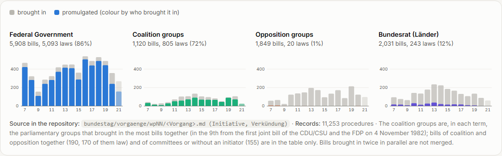

#### 2. Faster to the statute book

Days from the first step of a Government bill to promulgation: 333 (1972–1976), 167 in the 20th term.

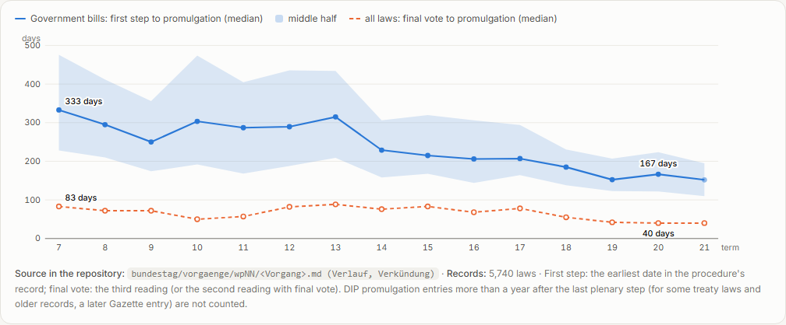

#### 3. The parliamentary year

The Bundestag's final votes on laws by month and year since 1972: 20% in June, 3 in an August.

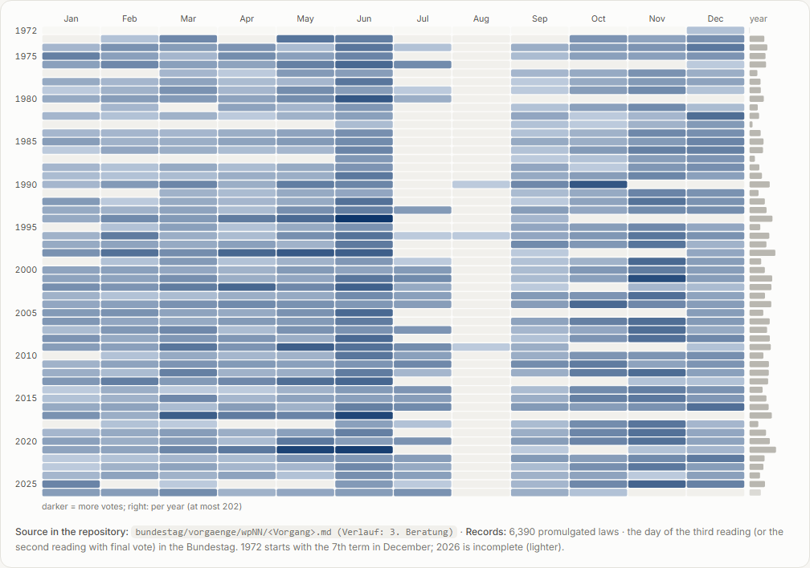

#### 4. How bills end

Promulgated, rejected, settled or lapsed: 29% of the Government's bills of the 20th term lapsed when it ended.

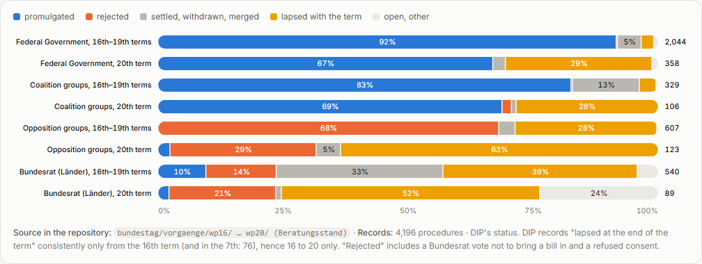

#### 5. Roll-call votes

How often two parliamentary groups voted alike, 19th to 21st term: the CDU/CSU and the SPD in all 93 votes of the 21st.

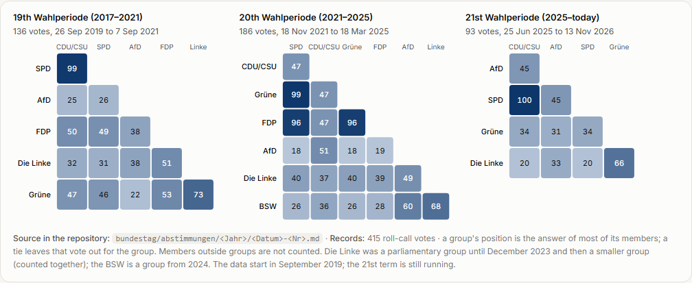

### II. The Federation and the Länder

#### 6. Consent laws

The share of laws that needed the Bundesrat's consent: 55% before the federalism reform of 2006, 37% after it.

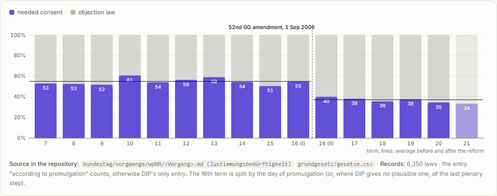

#### 7. The mediation committee

Laws that went through mediation, by term (23% in the 15th), refused consents, objections and the four laws the Federal President did not sign.

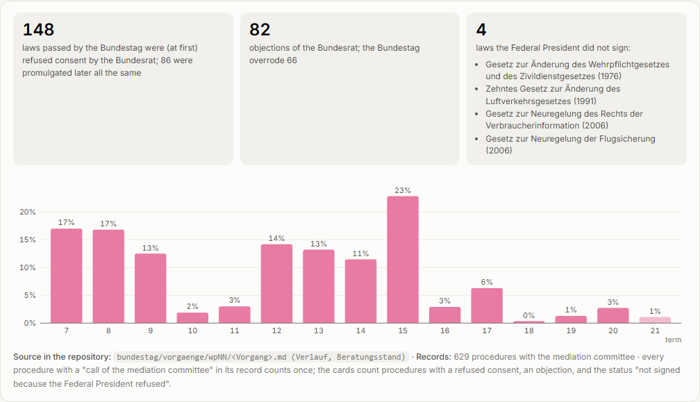

#### 8. The Länder's bills

Map of the bills from the Länder since 1990: Bavaria took part in 382, 31 became law.

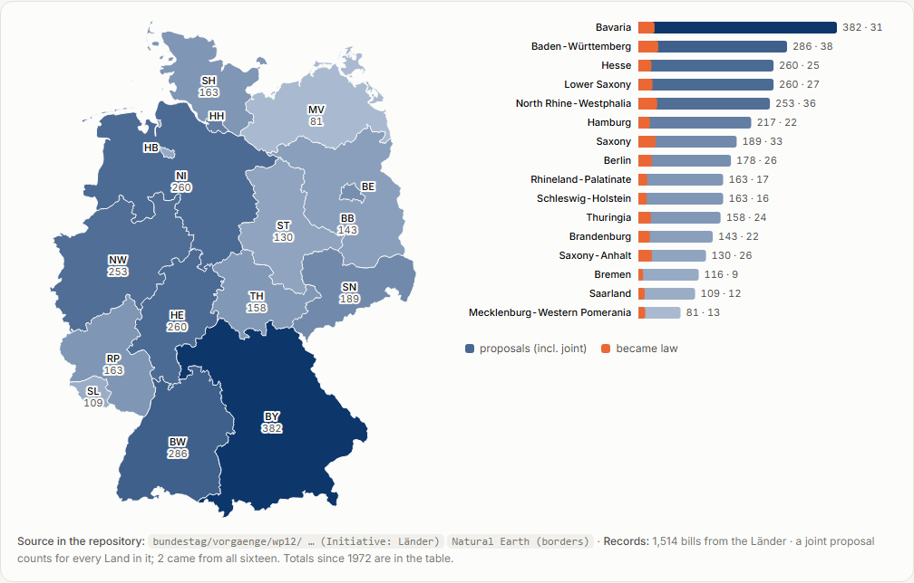

#### 9. Municipalities

The 10,747 municipalities of each Land by size: Rhineland-Palatinate has 2,300, almost half under 500 inhabitants; North Rhine-Westphalia 396.

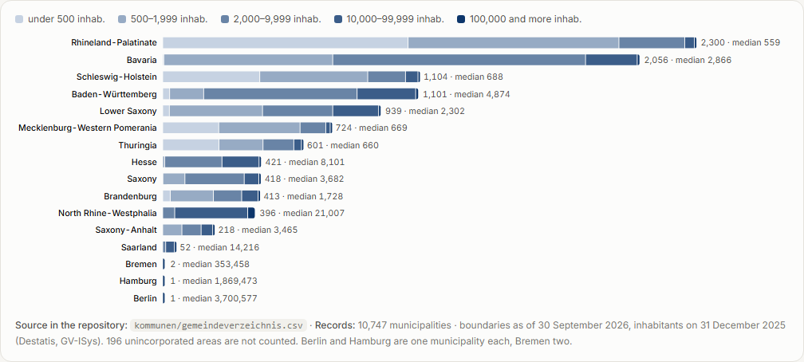

### III. What laws are about and when they apply

#### 10. What kind of laws

The promulgated laws by their title: treaty laws 38% in the 13th term, 8% in the 20th; more laws name EU law in their title.

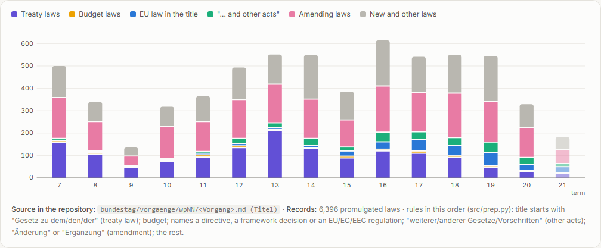

#### 11. Subjects

The twelve most common subject areas by term: "European policy and the EU" 19% of the laws of the 15th term, 4% of the 20th.

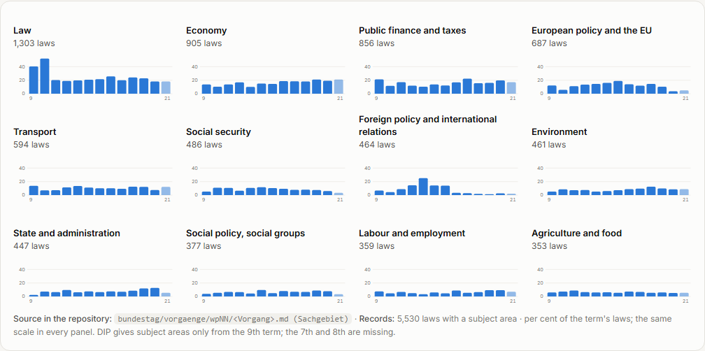

#### 12. Treaty partners

World map of the states whose treaties with Germany were approved by law: Poland 36, Austria 34, Switzerland 29.

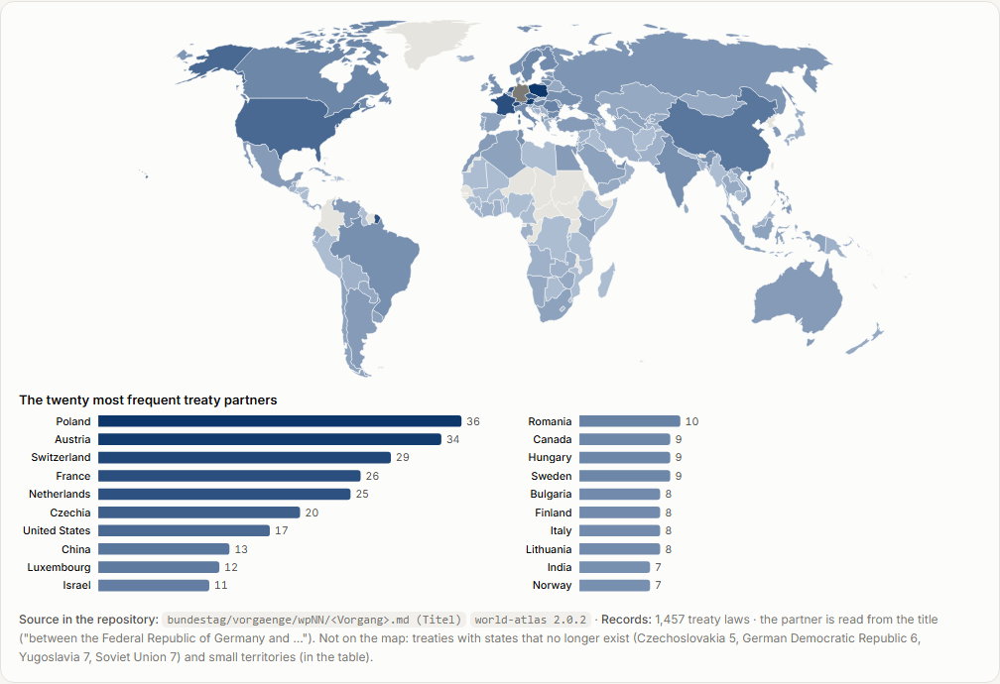

#### 13. Entry into force

The calendar of entry into force: 26% of laws took effect on 1 January, 49% on the first of a month.

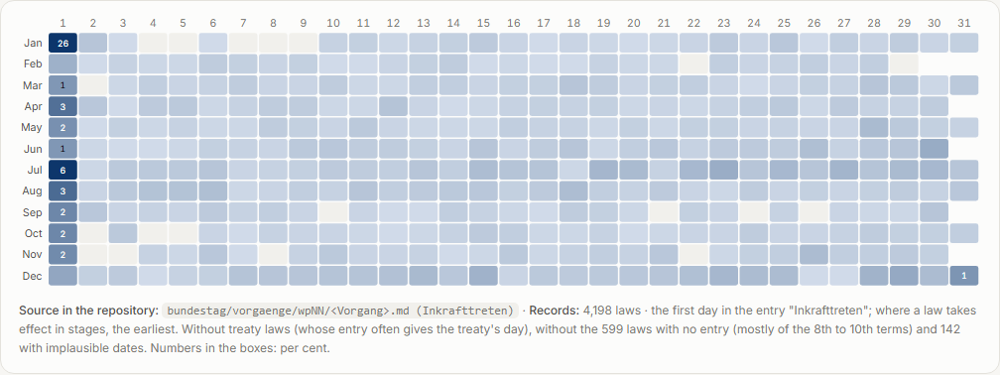

#### 14. Retroactive or later

The gap between promulgation and entry into force, by term: 46% the day after, 10% retroactively.

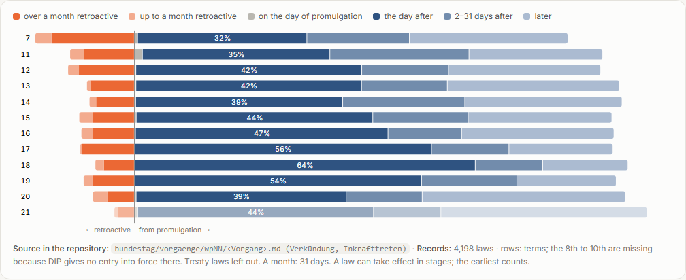

### IV. Federal law in force

#### 15. Old law still in force

The 6,147 federal acts by the decade they were signed: 187 from before 1949, the oldest the Gewerbeordnung (trade code) of 1869; 47 of them changed since 2019.

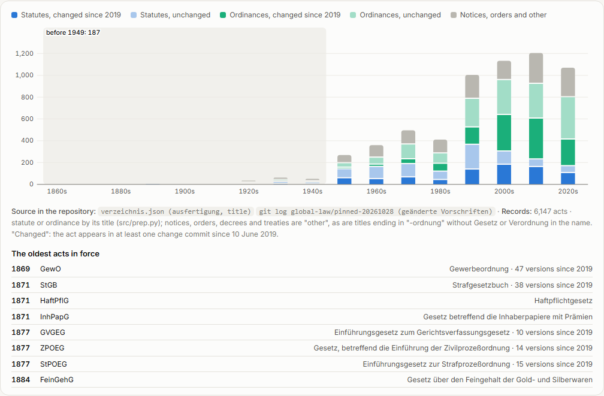

#### 16. Changed most often

New versions since June 2019 by act and year: Book V of the Social Code 136, the Civil Code 73.

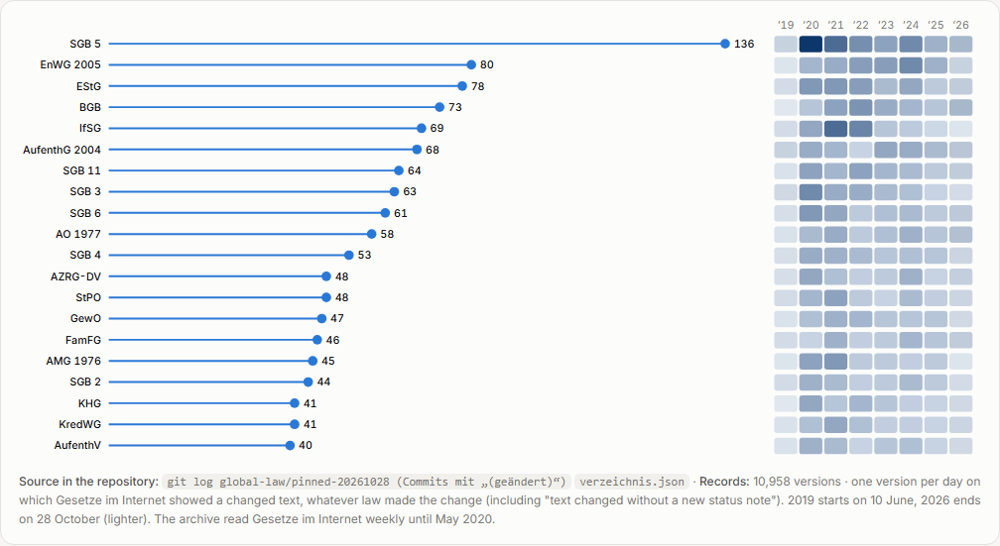

#### 17. Omnibus acts

Laws and ordinances that changed many acts at once: the eleventh ordinance adjusting ministries' names at least 127.

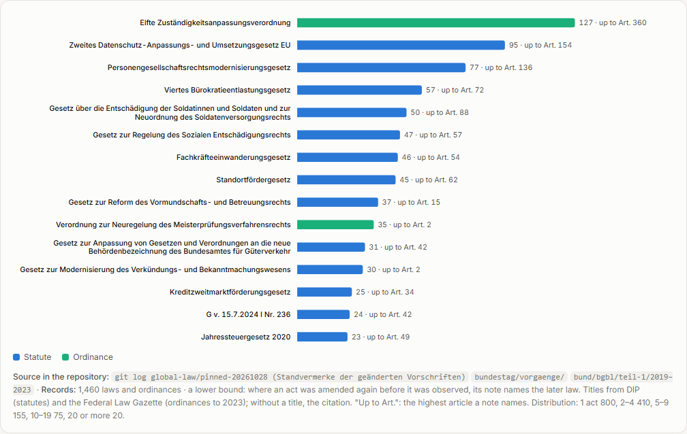

### V. The constitution and the Constitutional Court

#### 18. Incompatible or void

Senate decisions of the Federal Constitutional Court since 1998 that struck at provisions: 130 declared incompatible, 113 void.

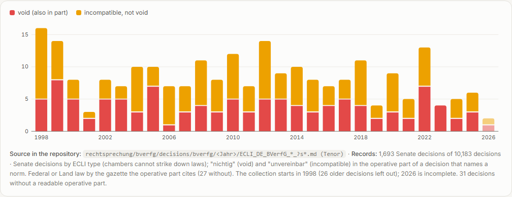

#### 19. Deadlines for the legislature

Every deadline for new rules as a bar from the decision to the day set: 67 deadlines, 15 months at the median.

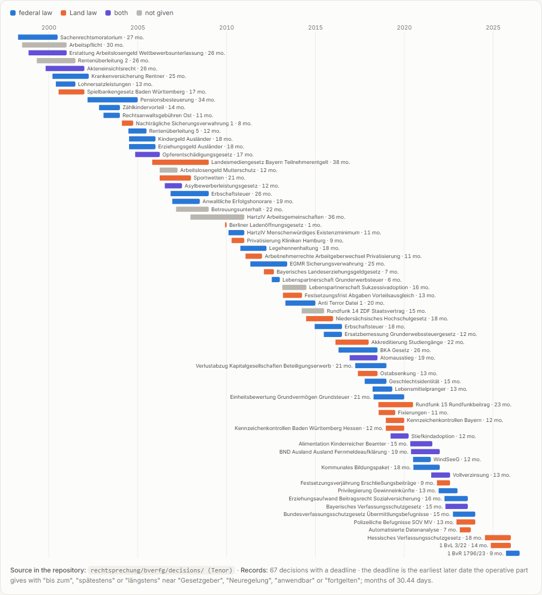

#### 20. Five constitutions

Length and basic-rights section of the constitutions of 1849, 1867, 1871, 1919 and of the Grundgesetz of 1949 and today.

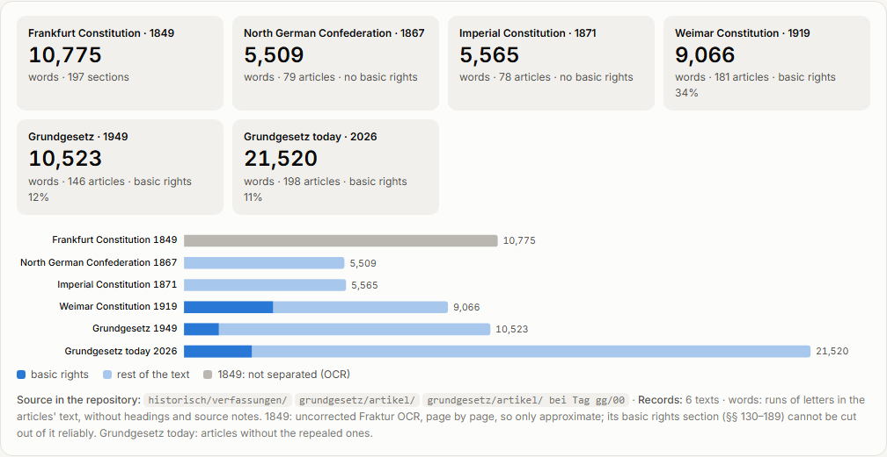

## Data

As of commit `288d42ae52` of `main` (19 November 2026).

| Dataset | Where in the repository | Records | Coverage |
| --- | --- | ---: | --- |
| Legislative procedures (DIP) | `bundestag/vorgaenge/` | 11,253 procedures, 6,396 promulgated laws | 7th to 21st term (December 1972 to November 2026) |
| Roll-call votes | `bundestag/abstimmungen/` | 415 votes | September 2019 to November 2026 |
| Federal acts | `verzeichnis.json` | 6,147 acts | Gesetze im Internet, as of 28 October 2026 |
| Changes to federal law | commits up to tag `global-law/pinned-20261028-6f3913a35a` | 3,231 commits | 10 June 2019 to 28 October 2026 |
| Federal Constitutional Court | `rechtsprechung/bverfg/` | 1,693 Senate decisions of 10,183 | 1998–2026 (a few older) |
| Register of municipalities | `kommunen/gemeindeverzeichnis.csv` | 10,747 municipalities | boundaries as of 30 September 2026 |
| Federal Law Gazette Part I (titles only) | `bund/bgbl/teil-1/2019` to `2023` | 1,898 entries | for the titles of the ordinances in chart 17 |
| Constitutions | `historisch/verfassungen/`, `grundgesetz/artikel/` (today and at tag `gg/00`) | 6 texts | 1849–2026 |

## Limits

- **DIP's data.** DIP gives subject areas only from the 9th term (chart 11), no entry into force in the 8th to 10th (charts 13 and 14), and the end of a term as an outcome only from the 16th (chart 4). Some promulgation entries, mostly of treaty laws and older records, cite a later Gazette; they are left out of the timings.
- **Coalition and opposition** (chart 1) are found from the parliamentary groups' joint bills, not from a list of governments; bills brought in twice in parallel are not merged.
- **Read from titles.** The kind of law (chart 10), the treaty partner (12) and the kind of act (15) come from words in titles, by the rules in `src/prep.py`; whatever no rule recognises is shown as "other".
- **Federal law before June 2019** is covered only as it stands today; changes count from 10 June 2019 (observed weekly until May 2020). The omnibus counts (chart 17) are lower bounds.
- **Federal Constitutional Court.** Counted are Senate decisions in the Court's collection from 1998, by words in the operative part; deadlines by the dates it gives (charts 18 and 19).
- **1849** is uncorrected Fraktur OCR; its word counts are approximate (chart 20).
- **Incomplete periods** (2026, the 21st term) are drawn lighter.
- **Not used:** the Land law under `laender/` (covered unevenly by Land and source), the municipalities' local law, the Bundestag's speeches, activities and printed papers, the Federal Law Gazette (apart from the titles of 2019–2023) and the other courts.

## Rebuilding

```sh
python visualisations/src/make.py            # git objects -> src/.build/ -> deutsches-recht-in-20-grafiken.html
node visualisations/src/stills.cjs           # images for these READMEs (needs Playwright; PLAYWRIGHT=<path> if not global)
```

`make.py` reads everything from git objects, also in a partial clone (`--filter=tree:0` or `--filter=blob:none`, `--no-checkout`): it fetches only the trees on the way to the folders it reads and some 22,000 files, in batches, and the 3,305 commits up to tag `global-law/pinned-20261028-6f3913a35a` without trees. It reads `origin/main` (or `HEAD`) by default; `--ref` picks another commit. It writes nothing into the repository except the page and the `src/.build/` folder (which git ignores).

| File | What it does |
| --- | --- |
| `src/make.py` | fetches the commits, trees and files it needs into `src/.build/`, then runs `prep.py` and `build.py` |
| `src/prep.py` | computes every number for the 20 charts and the data profile into `src/.build/data.json` |
| `src/page.tpl.html` | the page: text in both languages, the charts (d3), the tables |
| `src/build.py` | puts `data.json` into the template and writes the page |
| `src/stills.cjs` | draws each chart as a PNG into `stills/de/` and `stills/en/` |
| `src/laender.topo.json` | the borders of the sixteen Länder (Natural Earth, public domain) |
