# Deutsches Recht in 20 Grafiken

[English](README.en.md)

Grafiken zum Recht aller Länder, aus ganz global-law: [global-law visualisations/](https://github.com/lexifina/global-law/tree/main/visualisations). Hier stehen nur die Grafiken zu Deutschland.

Zwanzig Grafiken zum deutschen Recht, allein aus den Daten dieses Repositorys: jedes Gesetzgebungsverfahren des Bundestages seit 1972 mit Einbringung, Beratung, Vermittlungsausschuss und Verkündung; die namentlichen Abstimmungen seit 2019; das Verzeichnis aller Rechtsvorschriften des Bundes und ihre Änderungen seit Juni 2019; die Entscheidungen der Senate des Bundesverfassungsgerichts; das Gemeindeverzeichnis; und fünf deutsche Verfassungen von 1849 bis heute.

Öffnen Sie [`deutsches-recht-in-20-grafiken.html`](deutsches-recht-in-20-grafiken.html) in einem Browser. Die Seite ist eine einzige Datei mit allen Daten; aus dem Netz lädt sie nur die Bibliotheken d3 und topojson, die Weltkarte und die Schriften. Oben rechts wechseln Sie die Sprache (Deutsch oder Englisch) und die Darstellung (hell oder dunkel). Jede Grafik nennt ihren Pfad im Repository, die Zahl der Datensätze und ihre Grenzen und hat darunter eine Tabelle mit allen Zahlen. Die genauen Werte zeigt der Mauszeiger.

Die Grafiken beschreiben, was die Quellen verzeichnen, nicht warum.

## Die Grafiken

### I. Wie Bundesgesetze entstehen

#### 1. Wer Gesetze durchbringt

Eingebrachte und verkündete Entwürfe je Wahlperiode: 86 % der Regierungsentwürfe wurden Gesetz, 1,1 % der Oppositionsentwürfe, seit 1998 drei von 1.097.

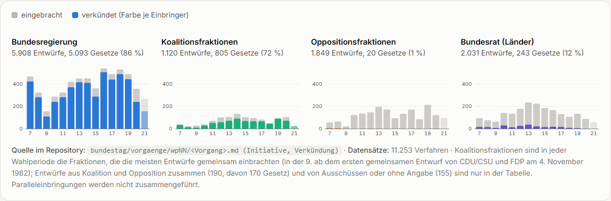

#### 2. Schneller zum Gesetz

Tage vom ersten Schritt eines Regierungsentwurfs bis zur Verkündung: 333 (1972–1976), 167 in der 20. Wahlperiode.

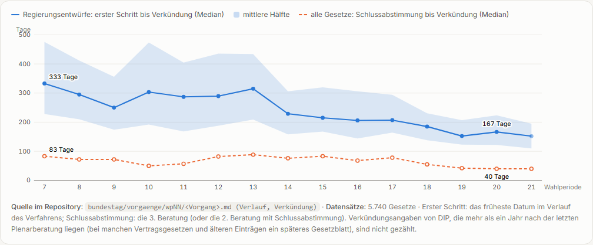

#### 3. Das Parlamentsjahr

Die Gesetzesbeschlüsse des Bundestages nach Monat und Jahr seit 1972: 20 % im Juni, 3 in einem August.

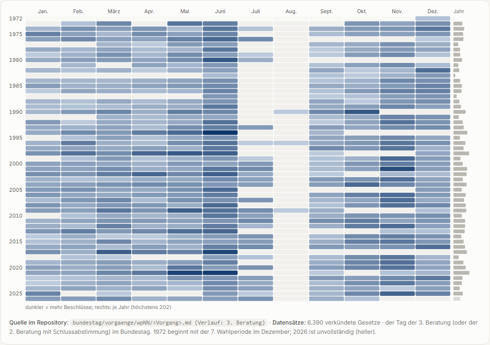

#### 4. Wie Entwürfe enden

Verkündet, abgelehnt, erledigt oder verfallen: 29 % der Regierungsentwürfe der 20. Wahlperiode verfielen mit ihrem Ende.

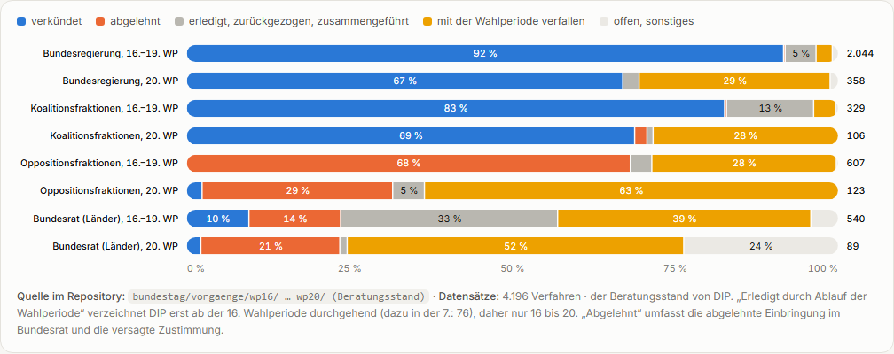

#### 5. Namentliche Abstimmungen

Wie oft zwei Fraktionen gleich stimmten, 19. bis 21. Wahlperiode: CDU/CSU und SPD in allen 93 Abstimmungen der 21.

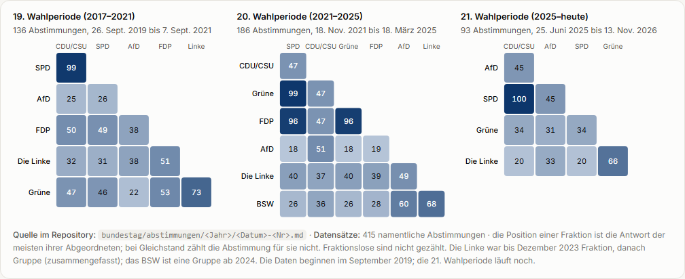

### II. Bund und Länder

#### 6. Zustimmungsgesetze

Der Anteil der Gesetze, die der Zustimmung des Bundesrates bedurften: 55 % vor der Föderalismusreform von 2006, 37 % danach.

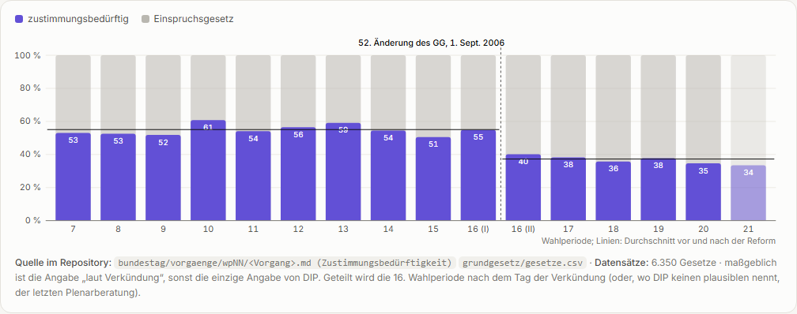

#### 7. Vermittlungsausschuss

Gesetze mit Vermittlungsverfahren je Wahlperiode (23 % in der 15.), versagte Zustimmungen, Einsprüche und die vier Gesetze, die der Bundespräsident nicht ausfertigte.

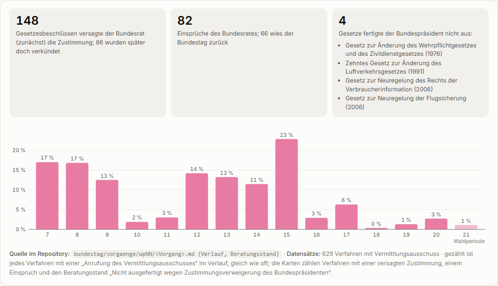

#### 8. Gesetzesanträge der Länder

Karte der Gesetzentwürfe aus den Ländern seit 1990: Bayern war an 382 beteiligt, 31 wurden Gesetz.

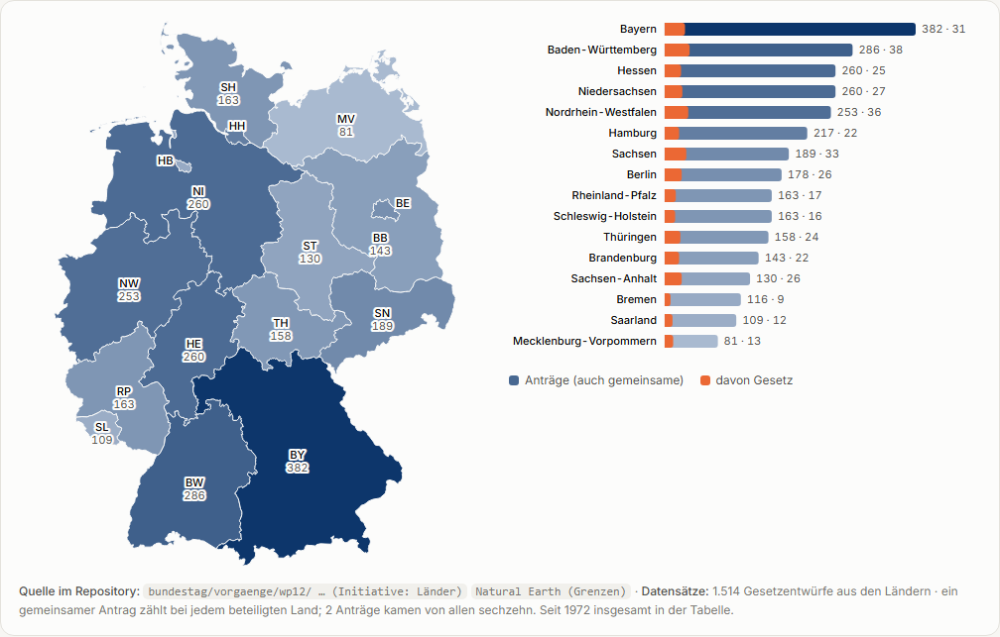

#### 9. Gemeinden

Die 10.747 Gemeinden je Land nach Größe: Rheinland-Pfalz hat 2.300, fast die Hälfte unter 500 Einwohnern; Nordrhein-Westfalen 396.

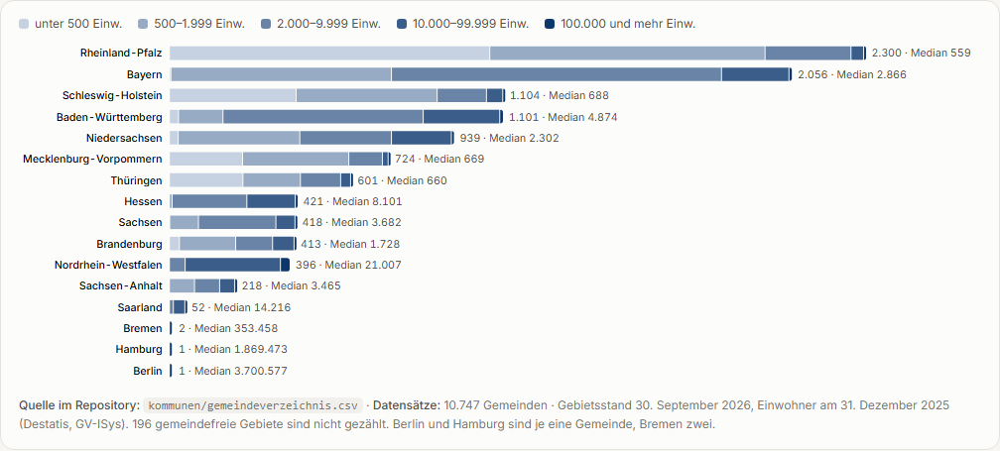

### III. Was Gesetze regeln und wann sie gelten

#### 10. Was für Gesetze

Die verkündeten Gesetze nach ihrem Titel: Vertragsgesetze 38 % in der 13. Wahlperiode, 8 % in der 20.; mehr Gesetze nennen EU-Recht im Titel.

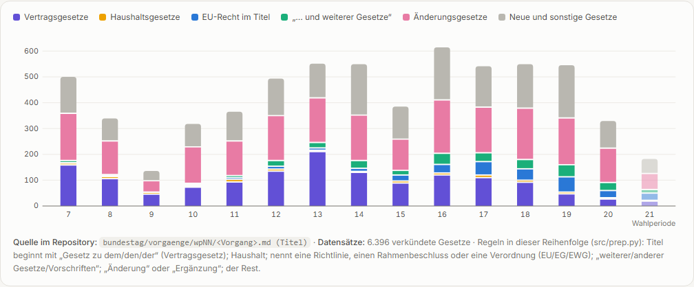

#### 11. Themen

Die zwölf häufigsten Sachgebiete je Wahlperiode: „Europapolitik und EU“ 19 % der Gesetze der 15. Wahlperiode, 4 % der 20.

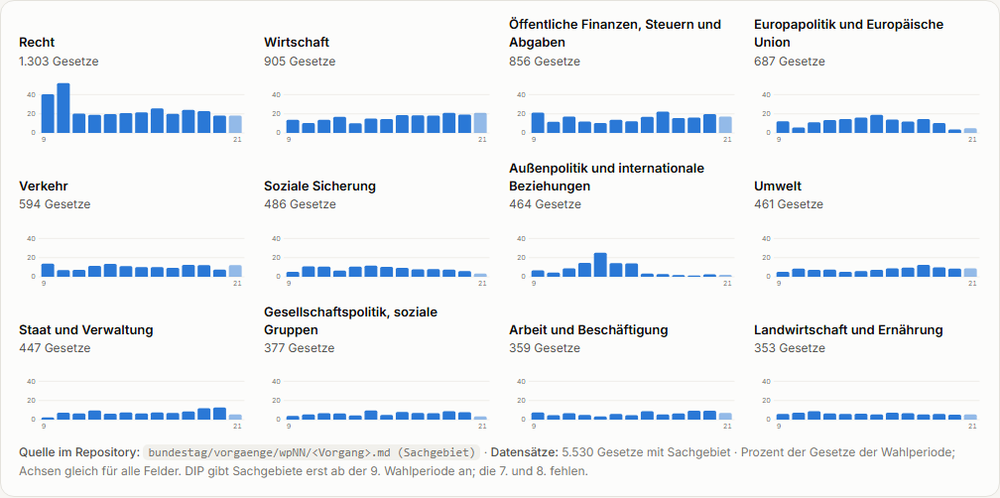

#### 12. Vertragspartner

Weltkarte der Staaten, mit denen Deutschland Verträge per Gesetz billigte: Polen 36, Österreich 34, Schweiz 29.

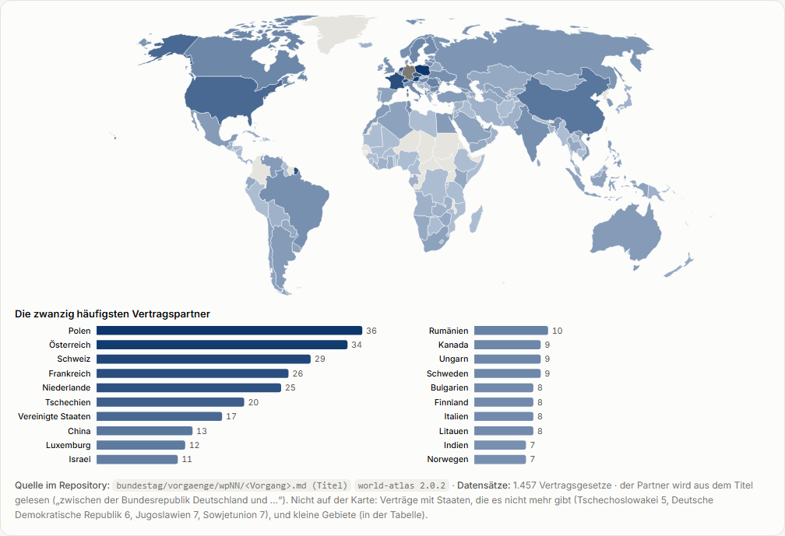

#### 13. Inkrafttreten

Der Kalender des Inkrafttretens: 26 % der Gesetze traten am 1. Januar in Kraft, 49 % an einem Monatsersten.

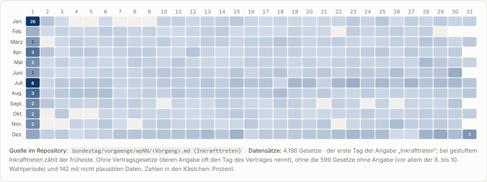

#### 14. Rückwirkend oder später

Abstand zwischen Verkündung und Inkrafttreten je Wahlperiode: 46 % am Tag danach, 10 % rückwirkend.

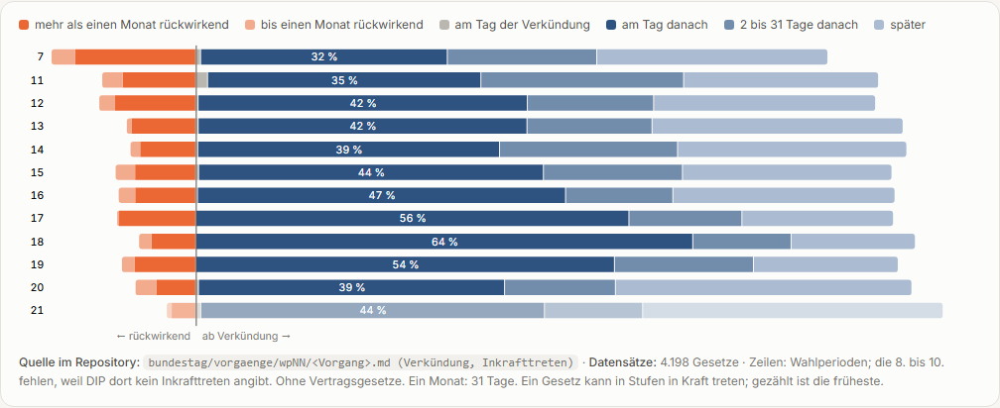

### IV. Das geltende Bundesrecht

#### 15. Altes Recht, das gilt

Die 6.147 Rechtsvorschriften nach dem Jahrzehnt ihrer Ausfertigung: 187 aus der Zeit vor 1949, die älteste die Gewerbeordnung von 1869; 47 davon seit 2019 geändert.

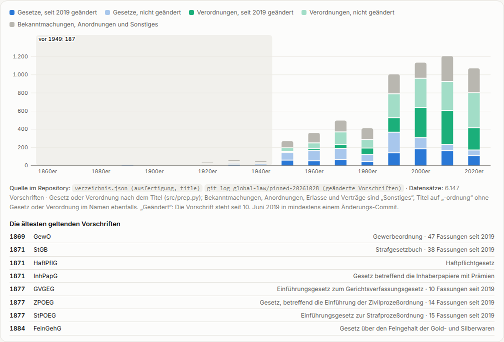

#### 16. Am häufigsten geändert

Neue Fassungen seit Juni 2019 je Vorschrift und Jahr: das Fünfte Buch Sozialgesetzbuch 136, das BGB 73.

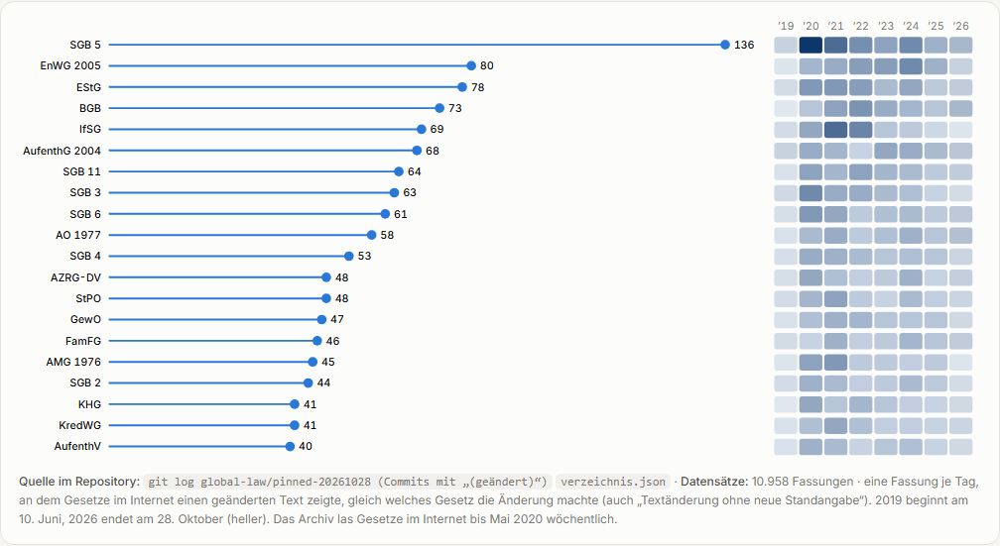

#### 17. Artikelgesetze

Gesetze und Verordnungen, die viele Vorschriften auf einmal änderten: die Elfte Zuständigkeitsanpassungsverordnung mindestens 127.

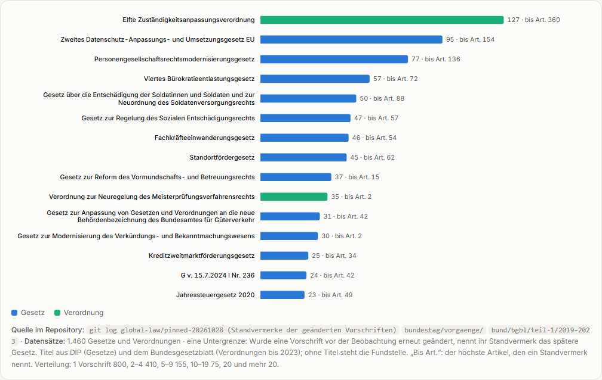

### V. Verfassung und Verfassungsgericht

#### 18. Unvereinbar oder nichtig

Senatsentscheidungen des Bundesverfassungsgerichts seit 1998, die Vorschriften verwarfen: 130 für unvereinbar, 113 für nichtig erklärt.

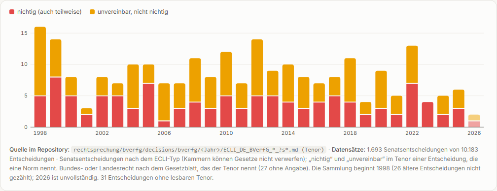

#### 19. Fristen für den Gesetzgeber

Jede Frist zur Neuregelung als Balken von der Entscheidung bis zum gesetzten Tag: 67 Fristen, im Median 15 Monate.

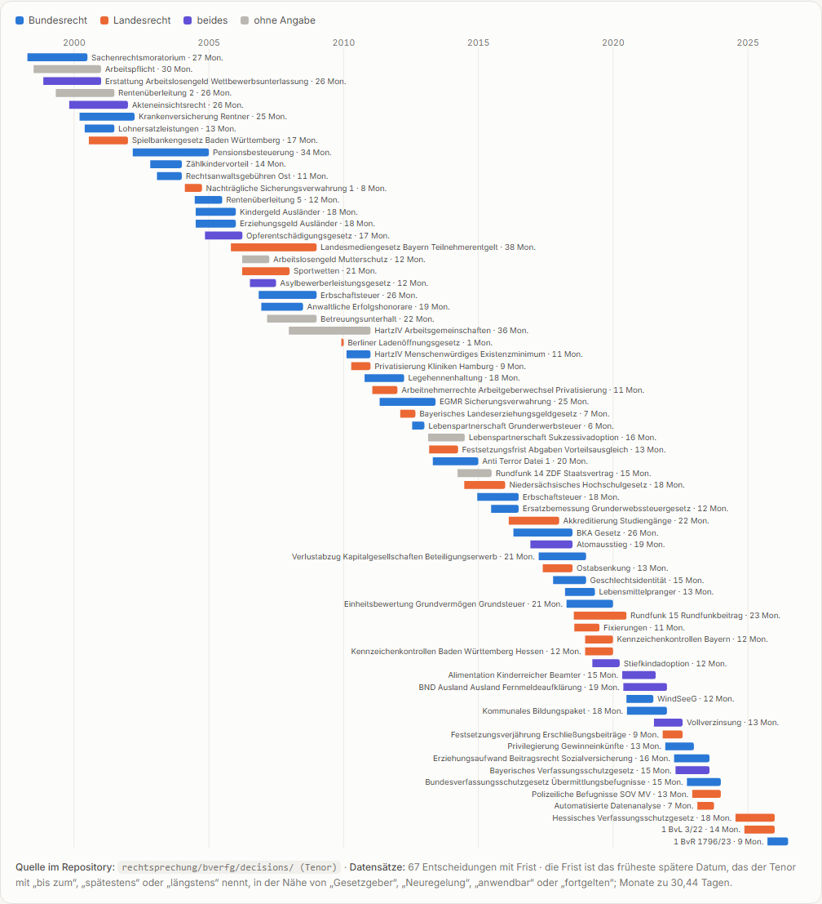

#### 20. Fünf Verfassungen

Länge und Grundrechtsteil der Verfassungen von 1849, 1867, 1871, 1919 und des Grundgesetzes von 1949 und heute.

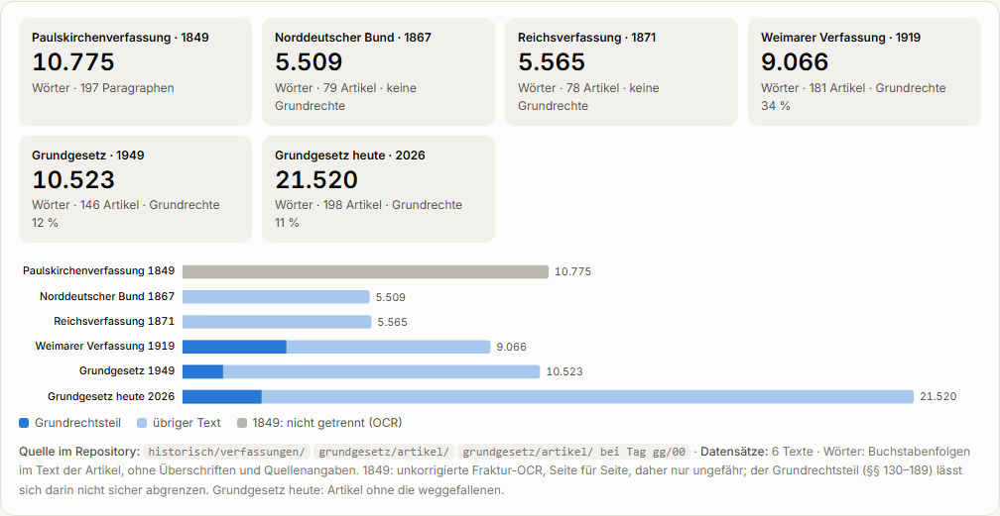

## Daten

Stand: Commit `288d42ae52` von `main` (19. November 2026).

| Datensatz | Ort im Repository | Datensätze | Abdeckung |
| --- | --- | ---: | --- |
| Gesetzgebungsverfahren (DIP) | `bundestag/vorgaenge/` | 11.253 Verfahren, 6.396 verkündete Gesetze | 7. bis 21. Wahlperiode (Dezember 1972 bis November 2026) |
| Namentliche Abstimmungen | `bundestag/abstimmungen/` | 415 Abstimmungen | September 2019 bis November 2026 |
| Rechtsvorschriften des Bundes | `verzeichnis.json` | 6.147 Vorschriften | Gesetze im Internet, Stand 28. Oktober 2026 |
| Änderungen des Bundesrechts | Commits bis Tag `global-law/pinned-20261028-6f3913a35a` | 3.231 Commits | 10. Juni 2019 bis 28. Oktober 2026 |
| Bundesverfassungsgericht | `rechtsprechung/bverfg/` | 1.693 Senatsentscheidungen von 10.183 | 1998–2026 (wenige ältere) |
| Gemeindeverzeichnis | `kommunen/gemeindeverzeichnis.csv` | 10.747 Gemeinden | Gebietsstand 30. September 2026 |
| Bundesgesetzblatt Teil I (nur Titel) | `bund/bgbl/teil-1/2019` bis `2023` | 1.898 Einträge | für die Titel der Verordnungen in Grafik 17 |
| Verfassungen | `historisch/verfassungen/`, `grundgesetz/artikel/` (heute und bei Tag `gg/00`) | 6 Texte | 1849–2026 |

## Grenzen

- **DIP-Daten.** Sachgebiete gibt DIP erst ab der 9. Wahlperiode an (Grafik 11), das Inkrafttreten nicht in der 8. bis 10. (Grafiken 13 und 14), das Ende einer Wahlperiode als Ergebnis erst ab der 16. (Grafik 4). Manche Verkündungsangaben, vor allem bei Vertragsgesetzen und älteren Einträgen, nennen ein späteres Gesetzblatt; für Zeitangaben sind sie ausgelassen.
- **Koalition und Opposition** (Grafik 1) sind aus den gemeinsamen Gesetzentwürfen der Fraktionen bestimmt, nicht aus einer Liste der Regierungen; Paralleleinbringungen werden nicht zusammengeführt.
- **Aus Titeln gelesen.** Gesetzesart (Grafik 10), Vertragspartner (12) und die Art einer Vorschrift (15) kommen aus Wörtern im Titel, nach den Regeln in `src/prep.py`; was keine Regel erkennt, steht unter „sonstige“.
- **Bundesrecht vor Juni 2019** ist nur als heutiger Bestand erfasst; die Änderungen zählen erst ab 10. Juni 2019 (bis Mai 2020 wöchentlich beobachtet). Die Zahlen der Artikelgesetze (Grafik 17) sind Untergrenzen.
- **Bundesverfassungsgericht.** Gezählt sind Senatsentscheidungen der Sammlung des Gerichts ab 1998, nach Wörtern im Tenor; Fristen nach Datumsangaben im Tenor (Grafiken 18 und 19).
- **1849** ist unkorrigierte Fraktur-OCR; Wortzahlen sind dort ungefähr (Grafik 20).
- **Unvollständige Zeiträume** (2026, die 21. Wahlperiode) sind heller gezeichnet.
- **Nicht verwendet:** das Landesrecht unter `laender/` (je Land und Quelle unterschiedlich weit erfasst), das Ortsrecht der Gemeinden, die Reden, Aktivitäten und Drucksachen des Bundestages, das Bundesgesetzblatt (bis auf die Titel 2019–2023) und die übrigen Gerichte.

## Neu erstellen

```sh
python visualisations/src/make.py            # Git-Objekte -> src/.build/ -> deutsches-recht-in-20-grafiken.html
node visualisations/src/stills.cjs           # Bilder für diese READMEs (braucht Playwright; PLAYWRIGHT=<Pfad>, falls nicht global)
```

`make.py` liest alles aus Git-Objekten, auch in einem partiellen Klon (`--filter=tree:0` oder `--filter=blob:none`, `--no-checkout`): Es holt nur die Bäume auf dem Weg zu den gelesenen Ordnern und etwa 22.000 Dateien, gebündelt, und die 3.305 Commits bis zum Tag `global-law/pinned-20261028-6f3913a35a` ohne Bäume. Standard ist `origin/main` (sonst `HEAD`); `--ref` wählt einen anderen Stand. Es schreibt nichts ins Repository außer der Seite und dem Ordner `src/.build/` (den Git ignoriert).

| Datei | Aufgabe |
| --- | --- |
| `src/make.py` | holt die Commits, Bäume und Dateien, die es braucht, nach `src/.build/` und ruft `prep.py` und `build.py` auf |
| `src/prep.py` | berechnet jede Zahl der 20 Grafiken und das Datenprofil nach `src/.build/data.json` |
| `src/page.tpl.html` | die Seite: Text in beiden Sprachen, die Grafiken (d3), die Tabellen |
| `src/build.py` | setzt `data.json` in die Vorlage und schreibt die Seite |
| `src/stills.cjs` | zeichnet jede Grafik als PNG nach `stills/de/` und `stills/en/` |
| `src/laender.topo.json` | die Grenzen der sechzehn Länder (Natural Earth, gemeinfrei) |
