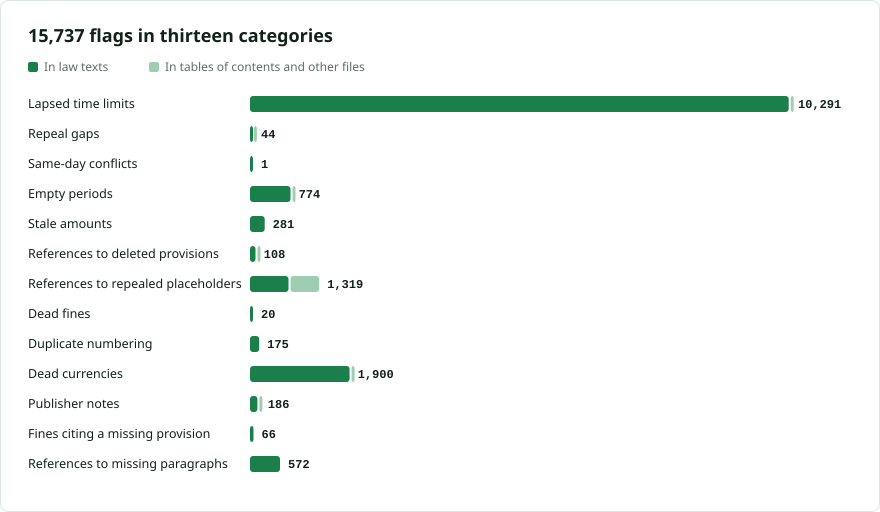

# Vulnerabilities in German federal law

[Deutsch](README.md) · **English**

<picture>
<source media="(prefers-color-scheme: dark)" srcset="img/flags-by-category-dark.svg">

</picture>

The vulnerability detectors from [lexifina/global-law](https://github.com/lexifina/global-law/tree/main/vulnerabilities) look for mechanical mistakes in legislation: a rule applying "until" a date that has passed, a time limit extended only after it had run out, a provision repealed before its replacement took effect, an amount changed in one place but still standing in another, a reference to a section that no longer exists, and, for Germany only, an administrative or criminal offence whose underlying rule is missing. global-law's published list (9 November 2026) covered Germany with 10,031 flags: 5,442 lapsed time limits, 1,895 dead currencies, 760 references to missing paragraphs, 683 references to repealed placeholders, 454 empty periods, 278 stale amounts, 186 failed amendments (here publisher notes), 175 duplicate numbering, 65 fines citing a missing provision, 44 repeal gaps, 39 references to deleted provisions and 10 missing enabling powers. This is a run over this repository only, the Grundgesetz and 6,147 federal acts and ordinances, as it stood at commit [`09422cd`](https://github.com/lexifina/germany-law/commit/09422cd9c7db5bcb5633a2f2641e0e2c0e6ff9b1) on 15 November 2026, with versions that appeared on Gesetze im Internet up to 28 October 2026. It finds 15,737 flags: the same 44 repeal gaps and 175 duplicate numbers, about as many dead currencies (1,900), stale amounts (281), publisher notes (186) and fines citing a missing provision (66), more lapsed time limits (10,291), references to repealed placeholders (1,319), empty periods (774) and references to deleted provisions (108), fewer references to missing paragraphs (572), and two categories that list did not have for Germany: dead fines (20) and same-day conflicts (1). Missing enabling powers were not searched for; they need citations that a model draws from the enacting formulas.

**In short:** the detectors raised 15,737 flags. A language model reviewed 391 of the strongest, arguing each one for and against; 160 survived. Checked by hand in this repository, five of them are likely gaps or drafting mistakes. Four time limits in three acts were extended only after they had run out, with no retroactive wording in the texts this repository holds: retirement on application for civil servants of the postal successor companies "until 31 December 2024" (§ 4 Abs. 1 BEDBPStruktG), extended to 2026 only by an act of 22 December 2025; the deemed approval of charging points of distribution system operators to the end of 2024 (§ 118 Abs. 34 EnWG), extended by an act of 21 February 2025; and two periods for preventive and rehabilitation facilities to 19 March 2022, extended by an ordinance promulgated on 11 April 2022 (two flags). And since 2024 § 1 Abs. 2a NetzDG deals only with repealed provisions. 93 come from how this repository is built and dated: a commit carries the day Gesetze im Internet first showed a change, not the day it took effect, so 92 extensions made in time look late. Of the other 62, 8 are lawful, 2 are spent, 5 were misread by a detector, 3 are the same figure in a separate rule, 1 is not law, and 43 extensions cannot be judged without the Bundesgesetzblatt, because Gesetze im Internet names no act for them. Reading the two categories of penalty provisions the model does not review turned up eight more likely drafting mistakes: fines and criminal provisions that point to a repealed or wrong provision, among them § 44 Abs. 1 Nr. 44b TierSchNutztV, which cites "§ 35 Absatz 7" instead of § 35a Abs. 7, § 34 Nr. 11 AWaffV, which points to § 12, moved into the Waffengesetz in 2020, and § 52 Abs. 2 Nr. 2 WeinV, a criminal provision for § 47, repealed on 2 September 2026. Later, this will be formalised in Lean, similar to our work on [the US tax code](https://lexifina.com/blog/formalizing-the-us-tax-code) and [US case law](https://lexifina.com/blog/formalizing-all-us-case-law-in-lean).

A flag is a prompt to look, not legal advice, and nothing here has been tested in court.

## Flags by category

| Category | What it looks for | Flags | In law texts | Reviewed | Survived review |
| --- | --- | ---: | ---: | ---: | ---: |
| Lapsed time limits | Text still applying a rule "until" a date that has passed | 10,291 | 10,267 | 40 | 2 |
| Repeal gaps | A provision removed before its replacement took effect | 44 | 36 | 40 | 0 |
| Same-day conflicts | Two acts changing the same provision with the same in-force day | 1 | 1 | 1 | 0 |
| Empty periods | A time limit extended by an act that took effect after it had run out | 774 | 771 | 230 | 146 |
| Stale amounts | An amount changed in one place but still standing elsewhere | 281 | 281 | 40 | 6 |
| References to deleted provisions | A provision citing a section that no longer exists | 108 | 104 | 40 | 6 |
| References to repealed placeholders | A provision citing a section that now reads only "(weggefallen)" | 1,319 | 734 | 0 | 0 |
| Dead fines | A fine or criminal provision citing a section that reads "(weggefallen)" | 20 | 20 | 0 | 0 |
| Duplicate numbering | Two units with the same number in one provision | 175 | 175 | 0 | 0 |
| Dead currencies | Amounts in currencies no longer in use | 1,900 | 1,899 | 0 | 0 |
| Publisher notes | Gesetze im Internet's notes on amendments that could not be carried out, and words such as "gegenstandslos" | 186 | 141 | 0 | 0 |
| Fines citing a missing provision | "Ordnungswidrig handelt, wer … entgegen § X Absatz Y …" where § X or its paragraph Y is missing or "(weggefallen)" in the same act (Germany only) | 66 | 66 | 0 | 0 |
| References to missing paragraphs | A reference to a paragraph that the section named, in the same act, does not have (Germany only) | 572 | 572 | 0 | 0 |

"In law texts" counts every file of the Grundgesetz and of the federal acts and ordinances. Not law are the root files, `data/`, `tools/`, the Grundgesetz's lists (`gesetze.csv`, `gesetze.json`, `KORREKTUREN.md`) and the tables of contents this repository adds to each act as `index.md`; 670 flags are there, 641 in tables of contents, 28 in `verzeichnis.json` and 1 in `stand.json`. Every provision is a file here, so the history detectors work as designed: a provision Gesetze im Internet no longer carries is a deleted file, and a provision that now reads only "(weggefallen)" stays as such. For federal law a commit carries the day the version first appeared on Gesetze im Internet and, where the footnotes give an earlier day of entry into force, that day; the date can therefore fall after the real entry into force, and an empty period of a few days is often only that lag. The commits give no day of promulgation for federal law, and for the Grundgesetz the detector does not read the `Verkuendet:` trailer, so the search for entry into force before promulgation found nothing.

*Edge cases: the 160 flags that survived the review, grouped by what they turned out to be, the eight likely mistakes found by reading, and what the other flags are, in [EDGE-CASES.en.md](EDGE-CASES.en.md).*

## Problems found in this repository

- **Two days without 1,480 provisions:** the commit of 5 May 2026 (["Textänderung ohne neue Standangabe"](https://github.com/lexifina/germany-law/commit/24104d571cca82541eac0bf33fbe96482ec88948)) deletes 1,480 files from 206 acts, 139 of them from the Energiewirtschaftsgesetz. By 7 May 2026 all are back, 1,434 through [a single commit](https://github.com/lexifina/germany-law/commit/aef0c2ef554c9eaccb083f24146eded2c9471784) and unchanged but for one file, the other 46 with two ordinances of the same day. For 5 and 6 May 2026 this repository therefore shows these provisions as absent, and the `git log` of each of these files holds a deletion and a re-creation that are not changes to the law.

## Files

| File | What it holds |
| --- | --- |
| [data/flags.csv](data/flags.csv) | Every flag, one row per provision and issue |
| [data/reviewed.csv](data/reviewed.csv) | The 391 flags the model reviewed, with its verdict and reason |
| [data/by_category.csv](data/by_category.csv) | The counts in the table above |
| [tools/](tools/) | The scripts that made this run |

Columns: `category` and `category_de` (the category in English and German), `detector`, `kind` (`law` or `other`), `path` (the provision in this repository), `date` (the date the flag turns on), `reference` (the act or line involved; for the two Germany-only categories the reference and what is missing), `summary`, `score` (the detector's ranking, 0 to 1), `review` (`artefact`, `lawful` or `candidate_defect`), `survives_rebuttal`, `review_note` (the model's reason, in English), `url` (the provision at the commit that was read, or, for a provision removed since, at the last commit that held it).

## How it was made

- **Detectors:** global-law's [vulnerabilities/scripts](https://github.com/lexifina/global-law/tree/main/vulnerabilities/scripts), with the fixes in [tools/patch_detectors.py](tools/patch_detectors.py) and the German ones in [tools/patch_de.py](tools/patch_de.py), run on this repository at commit `09422cd`, together with global-law's two Germany-only detectors, `owi_de.py` (fines citing a missing provision) and `subref_de.py` (references to missing paragraphs). The history table the detectors read was built from this repository's own commits (the act that made each change and its date from `In-Kraft:` or `In-Kraft-laut-Fussnote:`); all 3,304 dated commits count as law, text changes without a new status note included. For this run the search for dead currencies was corrected: an "S" after a number counts as the schilling only in Austria, not as a page, a stereo descriptor or an S-Bahn (1,954 flags became 1,900).
- **Model review:** gpt-5.4-mini, the 40 strongest flags per category; the 40 strongest lapsed time limits in law texts are the same 40. One pass says whether a flag is real, a second argues that it is not. Empty periods use global-law's own review for that category, on all 230 flags whose old and new dates open the same sentence, followed by the same second pass. The model does not review the other seven categories, the two Germany-only ones among them. global-law's own list used a different model.
- **Hand check:** every flag that survived was read in this repository's history and texts; for each empty period it was checked whether the change replaced the old date with the new one in the same line, and the date of the extending act was compared with the end of the period. All 20 dead fines and all 66 fines citing a missing provision were read, as were samples of the other categories. The amending acts' own texts in the Bundesgesetzblatt were not read: the five open gaps and the eight drafting mistakes still need the Bundesgesetzblatt.

To report a correction, open an issue with the provision and an official source.

## Licence

The lists and notes are Lexifina's, dedicated to the public domain under CC0 1.0 like this repository. Quoted law text is from Gesetze im Internet (Federal Ministry of Justice); acts and ordinances are official works and not protected by copyright (§ 5 Abs. 1 UrhG), and only the Bundesgesetzblatt is authoritative. See [LICENSE](../LICENSE).
